# OUTBREAK — Facilitator Guide

This guide is for the **instructor, teacher or facilitator** who runs OUTBREAK, the public health crisis simulation, with a group. It explains every screen, control, decision and score in enough depth for you to answer participants' questions, to steer discussion, and to interpret results.

Companion documents:
- [User Guide](USER_GUIDE.md): a plain-English guide for the **participants** who play. Hand it out before or during the session.
- [Technical Guide](TECHNICAL_GUIDE.md): the equations, constants and scoring formulas, with a full glossary.

### Facilitator quick start

1. Open `index.html` in a desktop browser on the machine connected to the projector ([§2](#2-running-the-simulation)).
2. Choose a **[scenario](#g-scenario)**, **difficulty**, **[seed](#g-seed)** and **[lobby](#g-lobby) count** ([§4](#4-screen-1--briefing-and-setup)). For your first session, use Novel Respiratory / Standard / [seed](#g-seed) `meridian` / 5 [lobbies](#g-lobby).
3. Switch to **Classroom** display ([§16](#16-classroom-projection-mode)).
4. Assign participants to [lobbies](#g-lobby), and brief them using the [User Guide](USER_GUIDE.md) ([§20](#20-planning-and-running-a-session)).
5. Run the 12 weeks, alternating **Debate view** (D) for argument with the controls for committing the agreed plan.
6. Use the Debrief and Class Scorecard for the closing discussion, and export the results ([§21](#21-assessment-and-collating-results)).

Terms that are not plain English link to the [Glossary](#22-glossary) at the end.

Before the session, read [§19](#19-model-behaviours-to-pre-empt). It lists the behaviours of the model that most often confuse a room.

---

## Contents

1. [What the simulation is](#1-what-the-simulation-is)
2. [Running the simulation](#2-running-the-simulation)
3. [The flow of a game](#3-the-flow-of-a-game)
4. [Screen 1 — Briefing and setup](#4-screen-1--briefing-and-setup)
5. [Screen 2 — Command Centre](#5-screen-2--command-centre)
6. [Resource sliders (left panel)](#6-resource-sliders-left-panel)
7. [Policy levers (right panel)](#7-policy-levers-right-panel)
8. [The weekly budget](#8-the-weekly-budget)
9. [Reading the centre panel](#9-reading-the-centre-panel)
10. [Forecasting](#10-forecasting)
11. [Advisors, situation panel and model notes](#11-advisors-situation-panel-and-model-notes)
12. [Screen 3 — Events](#12-screen-3--events)
13. [Screen 4 — Weekly report](#13-screen-4--weekly-report)
14. [Screen 5 — Debrief](#14-screen-5--debrief)
15. [Screen 6 — Class Scorecard](#15-screen-6--class-scorecard)
16. [Classroom (projection) mode](#16-classroom-projection-mode)
17. [Keyboard shortcuts](#17-keyboard-shortcuts)
18. [What participants commonly miss](#18-what-participants-commonly-miss)
19. [Model behaviours to pre-empt](#19-model-behaviours-to-pre-empt)
20. [Planning and running a session](#20-planning-and-running-a-session)
21. [Assessment and collating results](#21-assessment-and-collating-results)
22. [Glossary](#22-glossary)

---

## 1. What the simulation is

A novel [pathogen](#g-pathogen) has reached **Meridian City (population 500,000)**. You are the Emergency Public Health Director. For **12 simulated weeks** you set resources and policies within a fixed weekly [budget](#g-budget), then run the week and see the consequences.

The population has two groups:

| Group | Share | Size | Why it matters |
|---|---|---|---|
| General | 82% | 410,000 | Most infections; lower hospitalisation and fatality |
| [Clinically vulnerable](#g-clinically-vulnerable) | 18% | 90,000 | Hospitalised about 4× as often, and roughly 12–13× more likely to die per infection |

You are judged on three things that pull against each other: **deaths**, the **[Economy Index](#g-economy-index)** and **[Public Satisfaction](#g-satisfaction)**. In the classroom scorecard, these become separate interest groups ("[lobbies](#g-lobby)") that each grade the government.

Decisions **bind**: once a week has run, it cannot be undone. There is no undo or save, so if the room disagrees about a week, settle it before anyone presses RUN WEEK.

---

## 2. Running the simulation

OUTBREAK is a single file, `index.html`, with no build step and no server. Open it in a current desktop browser (Chrome, Edge, Firefox or Safari). An internet connection is only needed for the Google Fonts; if they are blocked, the interface falls back to system fonts and remains fully usable.

The only thing stored between sessions is your display-mode choice (Solo or Classroom), kept in the browser's local storage. A game in progress is **not** saved; reloading the page loses it.

---

## 3. The flow of a game

```
Briefing ──► [Event, if any] ──► Command Centre ──► RUN WEEK ──► Weekly Report ──┐
                ▲                                                                │
                └──────────────────────── next week (weeks 1–12) ◄───────────────┘
                                                                                 │
                                                     after week 12 ──► Debrief ──► Class Scorecard
```

Each week:

1. **An event may fire** before you see the controls. You must choose a response.
2. **You set your plan** in the Command Centre: sliders, policy tiers and toggles.
3. **You press RUN WEEK.** The model simulates seven days.
4. **The Weekly Report** summarises what happened. Press CONTINUE.

Your settings **carry over** from week to week. Nothing resets automatically. If you set a strict [lockdown](#g-lockdown) in week 2, it remains in place, and keeps costing money, until you change it.

---

## 4. Screen 1 — Briefing and setup

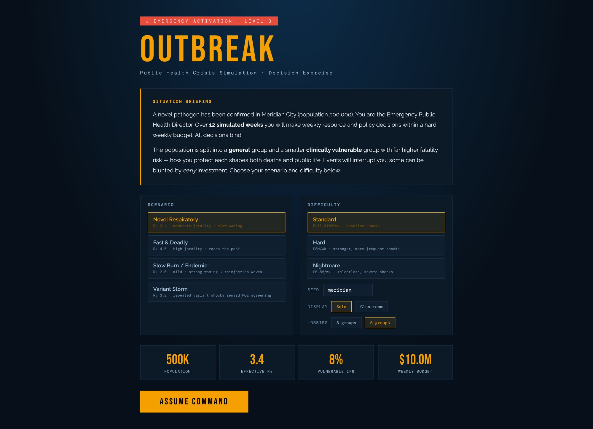

*The briefing screen: [scenario](#g-scenario), difficulty, [seed](#g-seed), display mode and [lobby](#g-lobby) count, with the summary tiles below.*

### Situation briefing
The opening text explains the premise. It has no controls.

### Scenario
Choose one of four [pathogens](#g-pathogen). Each has its own transmissibility ([R₀](#g-r0)), [fatality rates](#g-fatality-rate), rate at which [immunity](#g-immune) wears off ("waning"), the week vaccines become available, and the number of people infected at the start.

| [Scenario](#g-scenario) | Tag | [R₀](#g-r0) | Fatality (general / vulnerable) | Waning | Vaccine from | What it tests |
|---|---|---|---|---|---|---|
| **Novel Respiratory** | BASELINE | 3.4 | 0.6% / 8% | Slow (2%/wk) | Week 4 | A balanced, standard outbreak |
| **Fast & Deadly** | SEVERE | 4.5 | 1.2% / 14% | Very slow (1.2%/wk) | Week 5 | Speed of response; hospital [overflow](#g-overflow) |
| **Slow Burn / [Endemic](#g-endemic)** | PERSISTENT | 2.6 | 0.4% / 5% | Fast (9%/wk) | Week 4 | Reinfection waves; sustained management |
| **[Variant](#g-variant) Storm** | VOLATILE | 3.2 | 0.7% / 9% | Moderate (3%/wk) | Week 4 | [Variant](#g-variant) shocks; rewards early border screening |

In [Variant](#g-variant) Storm, the [variant](#g-variant) event is more likely to be drawn again in the random event schedule.

### Difficulty

| Difficulty | Weekly [budget](#g-budget) | [R₀](#g-r0) [multiplier](#g-multiplier) | Event [severity](#g-severity) | [Scheduled events](#g-scheduled-event) |
|---|---|---|---|---|
| **Standard** | $10.0M | ×1.0 | ×1.0 | 3 |
| **Hard** | $8.0M | ×1.1 | ×1.25 | 4 |
| **Nightmare** | $6.5M | ×1.2 | ×1.5 | 5 |

The [R₀](#g-r0) [multiplier](#g-multiplier) applies to the [scenario](#g-scenario)'s [R₀](#g-r0). For example, Novel Respiratory on Nightmare has [R₀](#g-r0) 3.4 × 1.2 ≈ 4.1.

### Seed
A text field (default `meridian`). The [seed](#g-seed), [scenario](#g-scenario) and difficulty together decide **which events happen in which weeks**. Two players with the same three settings get the same [scheduled events](#g-scheduled-event), which makes class comparisons fair. The [seed](#g-seed) does not affect the disease model, which is fully [deterministic](#g-deterministic). Some events are triggered by your own play (see [§12](#12-screen-3--events)), so they can differ between players even on the same [seed](#g-seed).

### Display
- **Solo** — the standard layout for one person at a screen.
- **Classroom** — a large-type, high-contrast projection layout with debate and scoreboard views. See [§16](#16-classroom-projection-mode).

The choice is remembered by the browser.

### Lobbies
Sets how many interest groups score the government on the Class Scorecard.
- **3 groups** — Business, General Public, Vulnerable.
- **5 groups** (default) — adds Healthcare and Treasury.

### Summary tiles
Four tiles update as you change the settings: Population, Effective [R₀](#g-r0) (after the difficulty [multiplier](#g-multiplier)), Vulnerable [fatality rate](#g-fatality-rate), and Weekly [Budget](#g-budget).

### ASSUME COMMAND
Starts the game. All sliders and toggles reset to zero/off, policies to None, and vaccine priority to Elderly first.

---

## 5. Screen 2 — Command Centre

This is where you spend almost all of your time.

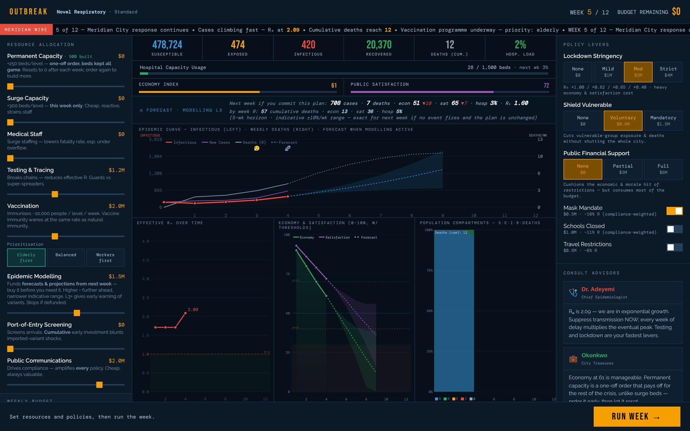

*The Command Centre in Solo mode, week 5, with modelling funded and two advisors open.*

It has six areas:

| Area | Position | Contents |
|---|---|---|
| Header | Top | [Scenario](#g-scenario) and difficulty, current week (of 12), **[Budget](#g-budget) Remaining** |
| News ticker | Below header | "MERIDIAN WIRE" headlines reflecting the current state |
| Left panel | Left | **Resource Allocation** sliders and the **Weekly [Budget](#g-budget)** breakdown |
| Centre panel | Middle | Population counts, hospital bar, economy and [satisfaction](#g-satisfaction) bars, [forecast](#g-forecast) strip, four charts |
| Right panel | Right | **Policy Levers**, Advisors, Active Situation, Model Notes |
| Footer | Bottom | Status message and the **RUN WEEK →** button |

### Header
- **[Budget](#g-budget) Remaining** is this week's [budget](#g-budget) minus everything currently selected. It is **green** when healthy, **amber** when less than 20% of the [budget](#g-budget) is left, and **red with a minus sign** when you are over [budget](#g-budget).

### News ticker
Scrolling headlines generated from the current state: the week, any breaking event, whether [Rₑ](#g-re) is high (above 1.4) or below 1, [cumulative](#g-cumulative) deaths, hospital strain (above 90% load), economy (below 40 or above 75), [satisfaction](#g-satisfaction) (below 40 or above 75) and the vaccine programme. It reflects what has happened; it is not an extra source of information.

### Footer
- The status message reads "Set resources and policies, then run the week", or warns that you are over [budget](#g-budget), and by how much.
- **RUN WEEK →** is disabled while you are over [budget](#g-budget).

---

## 6. Resource sliders (left panel)

Every resource is a slider from **level 0 to level 5**. The figure on the right of each slider is its cost **this week** (level × unit cost). In Classroom mode it is prefixed with the level, for example `L3 · $1.5M`.

Resources are charged **every week they are set above zero**. The exception is Permanent Capacity, which is a [one-off order](#g-one-off-order) (below).

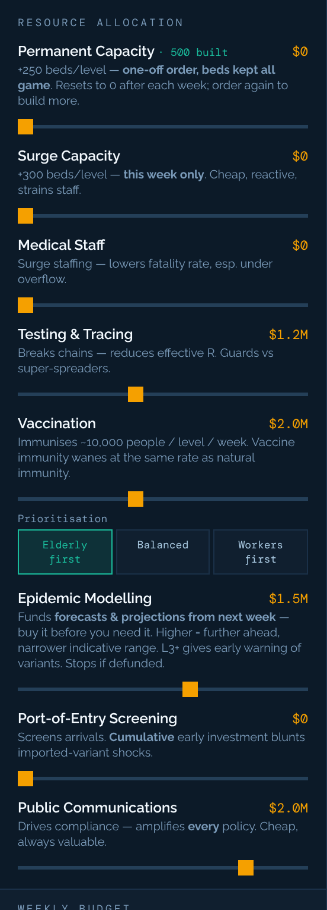

*The resource panel. The teal note beside Permanent Capacity shows the beds already built.*

### Permanent Capacity — $1.5M per level, one-off order
- Adds **250 hospital beds per level**, available immediately and **kept for the rest of the game**.
- The base hospital system has 1,000 beds.
- It is a **[one-off order](#g-one-off-order)**: after the week runs, the slider returns to 0, and the label shows the total built (for example `· 500 built`). To build more, order again in a later week.
- The weekly report confirms the beds commissioned and the new total.
- Best bought early: beds bought in week 1 serve for 12 weeks.

### Surge Capacity — $0.6M per level per week
- Adds **300 beds per level, for this week only**.
- Cheaper per bed than permanent capacity, but it disappears at the end of the week.
- Useful for responding to a [peak](#g-peak) you can see coming.

### Medical Staff — $1.0M per level per week
- Lowers the [fatality rate](#g-fatality-rate): by **9% per level** for the general group and **7% per level** for the vulnerable group (up to 45% / 35% at level 5).
- The reduction applies to the [fatality rate](#g-fatality-rate) whether or not hospitals are full. Its value is greatest when hospitals [overflow](#g-overflow), because [overflow](#g-overflow) multiplies fatality (see [§9](#9-reading-the-centre-panel)).
- Keeping staff at 0–1 while hospitals are above 80% full can trigger a **Hospital Staff Walkout** event.

### Testing & Tracing — $0.6M per level per week
- Cuts [transmission](#g-transmission) by **5.5% per level** (27.5% at level 5).
- Unlike [lockdown](#g-lockdown), masks and school closures, its effect does **not** depend on public [compliance](#g-compliance).
- Keeping testing at 0–1 while infections are above 3,000 and rising can trigger a **[Super-Spreader](#g-super-spreader) Cluster** event.

### Vaccination — $1.0M per level per week
- **Locked** (greyed out) until the [scenario](#g-scenario)'s vaccine week (week 4, or week 5 for Fast & Deadly).
- Each level immunises about **10,000 [susceptible](#g-susceptible) people per week**, so 50,000 per week at level 5.
- Vaccinated people become [immune](#g-immune), but that [immunity](#g-immune) **wears off at the same rate as natural [immunity](#g-immune)** for the [scenario](#g-scenario). The lever's description says so. In Slow Burn (9% per week), vaccination needs to be sustained.
- **Prioritisation** (three buttons below the slider) decides who gets doses first:

| Option | Who is vaccinated first | Effect |
|---|---|---|
| **Elderly first** (default) | All [susceptible](#g-susceptible) vulnerable people, then the general group | Cuts deaths fastest |
| **Balanced** | Both groups in proportion to how many are still [susceptible](#g-susceptible) | A middle course |
| **Workers first** | All [susceptible](#g-susceptible) general-group people, then the vulnerable | Removes more of the population driving [transmission](#g-transmission) |

Bonus doses from events also follow this setting. Doses received **before** the vaccine week are held in storage and administered in the first vaccine week; the event card and weekly report say so.

### Epidemic Modelling — $0.5M per level per week
- Funds the **[forecast](#g-forecast)**. Modelling is **bought a week in advance**: what you fund this week produces projections **next** week. See [§10](#10-forecasting).
- Higher levels give a longer [forecast](#g-forecast) [horizon](#g-horizon) and a narrower [indicative range](#g-indicative-range).
- At **level 3 or higher**, your modelling team spots [variants](#g-variant) early, which makes a [variant](#g-variant) event less severe (see [§12](#12-screen-3--events)).
- If you defund it, the [forecast](#g-forecast) stops the following week.

### Port-of-Entry Screening — $0.5M per level per week
- Gives a small ongoing reduction in [transmission](#g-transmission) (1% per level).
- Its main value is **[cumulative](#g-cumulative)**: every level-week of screening is added up. When a [variant](#g-variant) arrives, each accumulated level cuts the [variant](#g-variant)'s impact by 6%, up to a maximum of 75% (reached after 13 level-weeks, for example level 3 for five weeks).
- It costs a little economic output: 0.25 [index](#g-index) points per level per week.
- It can only help if it is bought **before** the [variant](#g-variant) arrives. The first [variant](#g-variant) always arrives in week 3, 4 or 5.

### Public Communications — $0.5M per level per week
- Raises **[compliance](#g-compliance)**, which scales how effective [lockdown](#g-lockdown), masks, school closures and [shielding](#g-shielding) are.
- At level 0, [compliance](#g-compliance) is 55%. Each level adds 9 points, reaching 100% at level 5.
- When any restriction is active ([lockdown](#g-lockdown), school closures, travel restrictions or [shielding](#g-shielding)), each level also adds 0.5 [satisfaction](#g-satisfaction) per week. Masks alone do not count as a restriction here.
- It is cheap and makes every policy you choose more effective.

---

## 7. Policy levers (right panel)

Tiered policies are a row of buttons; click one to select it. Toggles are on/off switches. All policies are charged **every week they are active**.

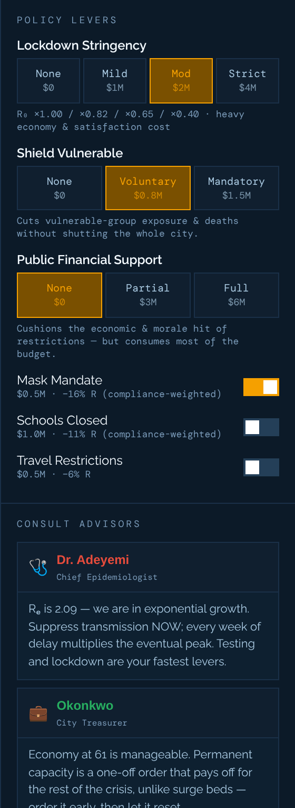

*The policy panel: tiered levers, toggles, and the advisors (Solo mode only).*

The "[R₀](#g-r0) ×" figures shown in the panel are what each policy achieves at **100% [compliance](#g-compliance)**. At lower [compliance](#g-compliance) they achieve proportionally less. With no communications and no financial support, [compliance](#g-compliance) is 55%, so a "×0.40" strict [lockdown](#g-lockdown) actually gives about ×0.67.

### Lockdown Stringency

| Tier | Cost/wk | [Transmission](#g-transmission) at full [compliance](#g-compliance) | Economy cost/wk | [Satisfaction](#g-satisfaction) cost/wk |
|---|---|---|---|---|
| None | $0 | ×1.00 | 0 | 0 |
| Mild | $1M | ×0.82 | −5 | −3 |
| Moderate | $2M | ×0.65 | −9 | −8 |
| Strict | $4M | ×0.40 | −17 | −13 |

- Moderate or Strict for **two or more consecutive weeks** while [satisfaction](#g-satisfaction) is below 55 can trigger **Anti-Restriction Protests**.
- Economy costs are reduced by Public Financial Support.

### Shield Vulnerable

| Tier | Cost/wk | Cut in vulnerable infections (full [compliance](#g-compliance)) | Economy/wk | [Satisfaction](#g-satisfaction)/wk |
|---|---|---|---|---|
| None | $0 | 0% | 0 | 0 |
| Voluntary | $0.8M | 40% | −0.4 | −1.0 |
| Mandatory | $1.5M | 68% | −0.9 | −3.0 |

[Shielding](#g-shielding) reduces how often vulnerable people **catch** the disease. It does not reduce [transmission](#g-transmission) in the general group. It protects the group most likely to die without closing the whole city. **Mandatory** [shielding](#g-shielding) counts as a restriction that prevents the economy's weekly recovery bonus (see [§9](#9-reading-the-centre-panel)); Voluntary does not.

### Public Financial Support

| Tier | Cost/wk | Restriction economic damage absorbed | [Satisfaction](#g-satisfaction)/wk | [Compliance](#g-compliance) bonus |
|---|---|---|---|---|
| None | $0 | 0% | 0 | 0 |
| Partial | $3M | 40% | +1.5 | +6 points |
| Full | $6M | 72% | +3.2 | +11 points |

Financial support only cushions the economic damage **caused by restrictions** ([lockdown](#g-lockdown), school closures, travel restrictions and [shielding](#g-shielding)). It does not offset economic losses from deaths or border screening. At $6M it takes 60% of the Standard [budget](#g-budget) and more than 90% of the Nightmare [budget](#g-budget).

### Mask Mandate — $0.5M/wk
Cuts [transmission](#g-transmission) by 16% × [compliance](#g-compliance). It has **no economy or [satisfaction](#g-satisfaction) cost**.

### Schools Closed — $1.0M/wk
Cuts [transmission](#g-transmission) by 11% × [compliance](#g-compliance). Costs 2 economy and 1.5 [satisfaction](#g-satisfaction) per week.

### Travel Restrictions — $0.5M/wk
Cuts [transmission](#g-transmission) by 6%, regardless of [compliance](#g-compliance). Costs 1.5 economy and 0.5 [satisfaction](#g-satisfaction) per week.

All [transmission](#g-transmission) reductions **multiply** together. For example, at full [compliance](#g-compliance), Moderate [lockdown](#g-lockdown) (×0.65) plus masks (×0.84) plus testing level 2 (×0.89) gives roughly ×0.49.

---

## 8. The weekly budget

The **Weekly [Budget](#g-budget)** box under the sliders shows:

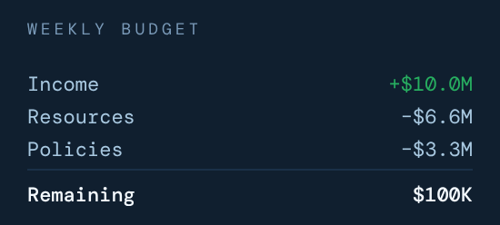

*Within [budget](#g-budget).*

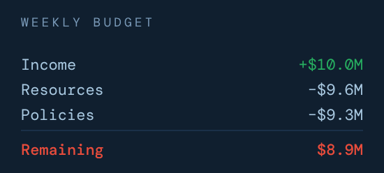

*Over [budget](#g-budget): Remaining turns red, the header shows a negative figure, and RUN WEEK is disabled.*

| Line | Meaning |
|---|---|
| Income | This week's [budget](#g-budget), including any grant from an event |
| Resources | Total of all slider costs |
| Policies | Total of all policy costs |
| Event response | The cost of the option you chose for this week's event (shown only if it is above zero) |
| Remaining | What is left; turns red if negative |

Rules:
- **Unspent money does not carry over** to the next week. If you spend less than half the [budget](#g-budget), the weekly report says so.
- You **cannot** run the week while over [budget](#g-budget).
- The cost of an event response is taken from **this week's** [budget](#g-budget). Choosing an expensive response leaves less for everything else.

---

## 9. Reading the centre panel

### Population counters
Six figures across the top:

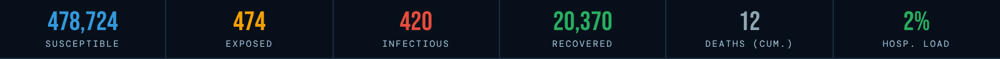

*Population counters.*

| Counter | Meaning |
|---|---|
| **[Susceptible](#g-susceptible)** | Can catch the disease, including people whose [immunity](#g-immune) has worn off |
| **[Exposed](#g-exposed)** | Infected but not yet [infectious](#g-infectious) (incubating; about 6 days on average) |
| **[Infectious](#g-infectious)** | Currently able to spread it (about 8 days on average) |
| **[Recovered](#g-recovered)** | Currently [immune](#g-immune), through recovery or vaccination |
| **Deaths ([cum.](#g-cumulative))** | Total deaths so far |
| **[Hosp. Load](#g-hospital-load)** | Last week's [peak](#g-peak) bed demand as a percentage of capacity. Green below 75%, amber 75–99%, red at 100% or above |

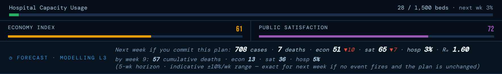

*The hospital bar (with next week's projected load), the Economy and [Satisfaction](#g-satisfaction) bars, and the [forecast](#g-forecast) strip.*

### Hospital Capacity Usage bar
Shows the beds in use out of the beds available (for example `812 / 1,250 beds`). When a [forecast](#g-forecast) is active, the projected load for next week is shown alongside it, with **⚠ [OVERFLOW](#g-overflow)** if it would reach 100%.

Bed demand comes from the number of people who are [infectious](#g-infectious) at the same time: about 5% of [infectious](#g-infectious) general-group people and 22% of [infectious](#g-infectious) vulnerable people need a bed. When demand exceeds capacity, **fatality rises steeply**. At double capacity, fatality is three times higher; the [multiplier](#g-multiplier) approaches five times as overload becomes extreme, with a ceiling of 10% (general) and 30% (vulnerable) fatality. Any [overflow](#g-overflow) during the week also costs 4 [satisfaction](#g-satisfaction) points.

### Economy Index and Public Satisfaction bars
Both run from 0 to 100 and start at 100. The colour is green or purple at 70 and above, amber from 40 to 69, and red below 40.

**The economy is driven by:**
- Restrictions ([lockdown](#g-lockdown), school closures, travel restrictions and [shielding](#g-shielding)), reduced by financial support
- Deaths: about −1 point per 90 deaths in a week
- Border screening: −0.25 per level
- A **+1.2 recovery bonus** each week with no [lockdown](#g-lockdown), no school closures, no travel restrictions, and no more than Voluntary [shielding](#g-shielding)

**[Satisfaction](#g-satisfaction) is driven by:**
- Restrictions (losses), financial support (gains), and communications (gains, only while restrictions are active)
- Deaths: about −1 point per 180 deaths in a week
- Hospital [overflow](#g-overflow): −4
- High case numbers: up to −4 (−1 per 10,000 new cases)
- Event outcomes

> **Economic collapse:** if the [Economy Index](#g-economy-index) reaches **0 in any week**, the debrief gives an automatic **F (ECONOMIC COLLAPSE)**, whatever the health outcome.

### Forecast strip
A one-line projection. See [§10](#10-forecasting).

### Epidemic Curve (main chart)
- **Red line with dots, shaded area**: people [infectious](#g-infectious), on the left axis.
- **Purple line**: new cases each week, on the left axis.
- **Grey line**: deaths each week, on the **right axis**, which has its own scale.
- **Dashed blue line with shaded band**: [forecast](#g-forecast) of [infectious](#g-infectious) people, when modelling is active.
- **Dashed grey line**: [forecast](#g-forecast) of weekly deaths.
- **Dashed amber "HOSP CAP" line**: the number of [infectious](#g-infectious) people at which hospitals would be full, given the current mix of patients between the two groups. It appears only when it falls within the chart's range. Because the mix can change from week to week, treat it as a guide; the hospital bar is the exact figure.
- **Event icons** above the curve mark the weeks in which events fired.
- **Hover** over a week to see its [infectious](#g-infectious) count, new cases, weekly and [cumulative](#g-cumulative) deaths, [Rₑ](#g-re), economy and [satisfaction](#g-satisfaction), and [lockdown](#g-lockdown) tier.

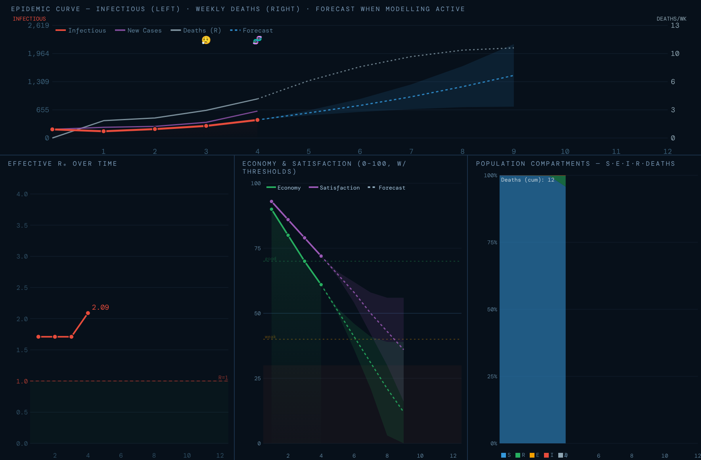

*The [epidemic curve](#g-epidemic-curve) with [forecast](#g-forecast) band, and the [Rₑ](#g-re), economy & [satisfaction](#g-satisfaction), and population [compartment](#g-compartment) charts.*

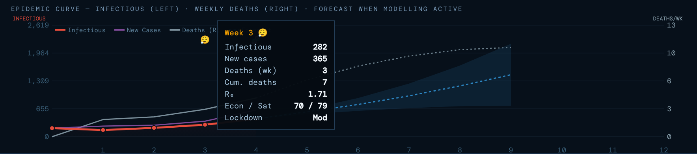

*Hovering over a week shows that week's figures.*

### Effective Rₑ over time
The average number of new infections each case caused that week. It combines the effect of your policies with how many people are already [immune](#g-immune) (or [shielded](#g-shielding)). The line is red above 1 and green at or below 1, and a dashed line marks R = 1. Above 1 means infections are growing; below 1 means they are shrinking. This is approximate: there is a [lag](#g-lag) of a few days while newly infected people incubate, and [waning immunity](#g-waning-immunity) adds people back to the [susceptible](#g-susceptible) group.

### Economy & Satisfaction chart
Both indices over time. Dotted guide lines mark 70 ("good") and 40 ("weak"), and the shaded red zone below 30 is the danger area. [Forecast](#g-forecast) lines and bands appear when modelling is active.

### Population Compartments chart
A stacked area chart of the whole population as percentages: [Susceptible](#g-susceptible) (blue), [Recovered](#g-recovered) (green), [Exposed](#g-exposed) (amber), [Infectious](#g-infectious) (red), Deaths (grey). [Cumulative](#g-cumulative) deaths are labelled at the top left.

---

## 10. Forecasting

[Forecasts](#g-forecast) are a capability you **buy in advance**:

- The [forecast](#g-forecast) you see **this week** depends on the [Epidemic Modelling](#g-epidemic-modelling) level you funded **last week**.
- The level you fund **this week** decides next week's [forecast](#g-forecast).
- You cannot briefly raise the slider, read a projection, and lower it again at no cost.

### What the strip shows

| State | Message |
|---|---|
| Not funded last week, not funded now | "[Forecast](#g-forecast) — locked" |
| Not funded last week, funded now | "[Forecast](#g-forecast) — active next week" |
| Funded last week | A projection of next week if you commit to the current plan: new cases, deaths, economy (with change), [satisfaction](#g-satisfaction) (with change), [hospital load](#g-hospital-load) and [Rₑ](#g-re), then the position at the end of the [horizon](#g-horizon), the [horizon](#g-horizon) length and the [indicative range](#g-indicative-range) |

The projection **updates live** as you move sliders and change policies, so you can compare plans before you commit to one.

### Horizon and band by level funded last week

| Level | [Horizon](#g-horizon) | [Indicative range](#g-indicative-range) (± per week ahead) |
|---|---|---|
| 1 | 3 weeks | ±30% |
| 2 | 4 weeks | ±15% |
| 3 | 5 weeks | ±10% |
| 4 | 6 weeks | ±7.5% |
| 5 | 6 weeks | ±6% |

The range widens with each week further ahead. Below level 3, the strip adds "raise modelling to see further". The range is indicative: it is a visual guide to how far the projection might move, not a statistical interval.

### What the forecast assumes
- You keep **exactly the current plan** for every future week, except that a one-off Permanent Capacity order is not repeated.
- The first projected week (the week you are planning) **includes this week's event and the response you chose**.
- **No further events occur** after this week.
- Vaccination counts only if it is already available this week.

If your plan does not change, the next-week projection matches what actually happens, including in event weeks, and the strip says so. Differences further ahead come from later events and from your own later changes. Higher modelling buys a longer view and a narrower range, not a more accurate next week. See the Technical Guide, §6.

Warnings in the strip:
- **"⚠ modelling unfunded this week — [forecast](#g-forecast) stops next week"** when the slider is at 0.
- **"· L*n* funded, effective next week"** when this week's level differs from last week's.

---

## 11. Advisors, situation panel and model notes

### Consult Advisors (Solo mode only)
Click an advisor to open or close their advice. Advice updates as you change your plan.

| Advisor | Role | Advises on |
|---|---|---|
| 🩺 Dr. Adeyemi | Chief [Epidemiologist](#g-epidemiologist) | Last week's [Rₑ](#g-re) (above 1.5, above 1, or below 1) and whether infection is concentrated in the vulnerable group |
| 💼 Okonkwo | City Treasurer | Economy below 40, the cost of strict [lockdown](#g-lockdown), the value of permanent capacity |
| 🎙️ Vance | Communications Chief | [Satisfaction](#g-satisfaction) below 40, restrictions with communications below level 2 |

Advisors each see one side of the problem and can contradict each other.

### Active Situation
After you respond to an event, a red-edged panel restates the event and your choice. It lasts for the current week only.

### Model Notes (Solo mode only)
A short summary of the model's assumptions: two groups, [waning immunity](#g-waning-immunity) (including vaccine [immunity](#g-immune)), that [Rₑ](#g-re) includes [immunity](#g-immune), the exact condition for the economy's +1.2 weekly recovery, and how the scores are weighted.

---

## 12. Screen 3 — Events

At the start of a week, an event card may appear **before** the Command Centre. At most one event occurs per week. You **must** pick one response; there is no option to close the card without choosing. The response's cost is taken from this week's [budget](#g-budget), and its effects last **this week only**.

The card has a red top edge for a crisis and a green one for good news. Text in teal tells you when an earlier investment you made has reduced the impact.

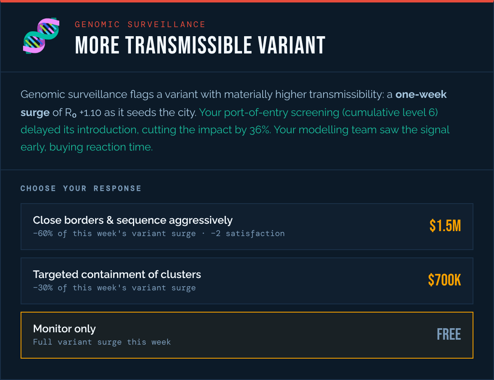

*The [variant](#g-variant) event card. The teal text shows that border screening and modelling have reduced its impact.*

### How events are chosen
- **[Scheduled events](#g-scheduled-event)** are fixed at the start by the [seed](#g-seed), [scenario](#g-scenario) and difficulty: 3, 4 or 5 of them in weeks 3–11. A **[variant](#g-variant) always appears** in week 3, 4 or 5.
- **[Triggered events](#g-triggered-event)** fire only in a week with no [scheduled event](#g-scheduled-event), at least two weeks after the previous [triggered event](#g-triggered-event), and only when their condition is met (checked in this order):
  1. **Protests**: Moderate or Strict [lockdown](#g-lockdown) for 2+ consecutive weeks **and** [satisfaction](#g-satisfaction) below 55.
  2. **[Super-spreader](#g-super-spreader)**: testing at level 0–1 last week, infections rising, **and** more than 3,000 [infectious](#g-infectious).
  3. **Staff walkout**: medical staff at level 0–1 last week **and** hospitals above 80% full.

"[Severity](#g-severity)" below is the difficulty's event [severity](#g-severity) (×1.0, ×1.25 or ×1.5).

### 🧬 More Transmissible Variant (scheduled)
A **one-week surge** in [R₀](#g-r0) of **1.4 × [severity](#g-severity)**, or **1.1 × [severity](#g-severity)** if you funded modelling at level 3+ last week. Accumulated [port-of-entry](#g-port-of-entry) screening then cuts this by 6% per level-week (maximum 75%). The card states that the surge lasts one week.

| Response | Cost | Effect |
|---|---|---|
| Close borders & sequence aggressively | $1.5M | 40% of the surge applies; −2 [satisfaction](#g-satisfaction) |
| Targeted containment of clusters | $0.7M | 70% of the surge applies |
| Monitor only | Free | The full surge applies |

### 🏥 Healthcare Worker Burnout (scheduled)
Raises fatality this week by 25% × [severity](#g-severity). The Medical Staff level does not change this event; only the response does.

| Response | Cost | Effect |
|---|---|---|
| Emergency retention bonuses | $1.2M | No fatality increase |
| Redeploy trained reserves | $0.5M | Half the increase |
| Ask staff to push through | Free | The full increase; −3 [satisfaction](#g-satisfaction) |

### 📱 Misinformation Surge (scheduled)
Cuts [compliance](#g-compliance) this week by 28% × [severity](#g-severity). The Communications level does not change this event; only the response does.

| Response | Cost | Effect |
|---|---|---|
| Rapid counter-messaging campaign | $1.0M | 15% of the loss applies; −1 [satisfaction](#g-satisfaction) |
| Partner with trusted local voices | $0.4M | Half the loss; −2 [satisfaction](#g-satisfaction) |
| Ignore it | Free | The full loss; −6 [satisfaction](#g-satisfaction) |

### 😮‍💨 Lockdown Fatigue (scheduled)
Cuts [lockdown](#g-lockdown) effectiveness by 26% × [severity](#g-severity).

| Response | Cost | Effect |
|---|---|---|
| Announce a public support package | $1.0M | 15% of the loss applies; +2 [satisfaction](#g-satisfaction) |
| Renewed public messaging | $0.5M | Half the loss |
| Do nothing | Free | The full loss; −4 [satisfaction](#g-satisfaction) |

### 🤝 International Aid Grant (scheduled, good news)

| Response | Cost | Effect |
|---|---|---|
| Accept — general relief fund | Free | +$4M [budget](#g-budget) this week |
| Accept — earmarked, plus matched vaccines | Free | +$3M [budget](#g-budget) and 8,000 doses (held until vaccination opens, if it has not yet) |

### 💉 Vaccine Supply Windfall (scheduled, good news)

| Response | Cost | Effect |
|---|---|---|
| Fast-track distribution | $0.4M | +22,000 doses |
| Standard rollout | Free | +13,000 doses |

If the windfall arrives before vaccination opens, the doses are held and administered in the first vaccine week.

### 📢 Anti-Restriction Protests (triggered)

| Response | Cost | Effect |
|---|---|---|
| Ease restrictions to relieve pressure | Free | [Lockdown](#g-lockdown) is 32% less effective this week; −1 [satisfaction](#g-satisfaction) |
| Hold firm | Free | −8 [satisfaction](#g-satisfaction); [compliance](#g-compliance) ×0.75 |
| Open dialogue + financial support | $1.0M | −2 [satisfaction](#g-satisfaction) |

### 🦠 Super-Spreader Cluster (triggered)
About 9,000 × [severity](#g-severity) extra people are infected at once at the start of the week. [Shielding](#g-shielding) protects some of the vulnerable people among them.

| Response | Cost | Effect |
|---|---|---|
| Mass testing blitz | $1.2M | 20% of the cluster gets through |
| Localised [lockdown](#g-lockdown) of the area | $0.5M | 50% gets through; −2 [satisfaction](#g-satisfaction) |
| Manual [contact tracing](#g-contact-tracing) only | Free | The full cluster |

### ⛑️ Hospital Staff Walkout (triggered)

| Response | Cost | Effect |
|---|---|---|
| Meet staffing demands | $1.2M | Capacity ×0.95 |
| Bring in agency & military reserves | $0.5M | Capacity ×0.85 |
| Refuse to negotiate | Free | Capacity ×0.68; −4 [satisfaction](#g-satisfaction) |

---

## 13. Screen 4 — Weekly report

After each week, a report summarises it.

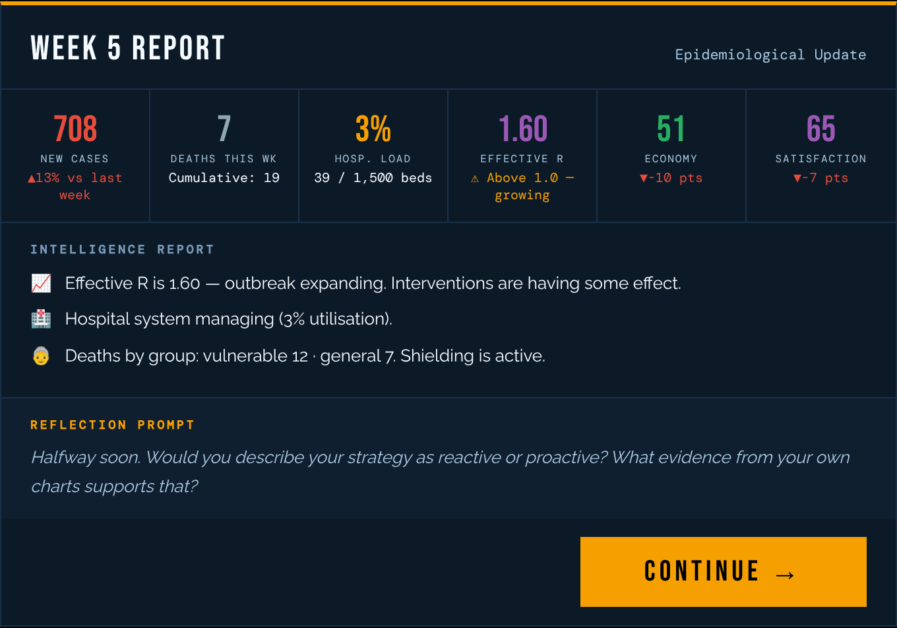

*A weekly report.*

### Six headline figures

| Figure | Detail line |
|---|---|
| New Cases | Change from last week: red if up, green if down |
| Deaths This Wk | [Cumulative](#g-cumulative) deaths |
| [Hosp. Load](#g-hospital-load) | [Peak](#g-peak) beds in use / beds available |
| [Effective R](#g-re) | "✓ Below [epidemic threshold](#g-epidemic-threshold)" or "⚠ Above 1.0 — growing" (see [Rₑ](#g-re) in [§9](#9-reading-the-centre-panel)) |
| Economy | Change in points |
| [Satisfaction](#g-satisfaction) | Change in points |

### Intelligence Report
Automatic notes on what happened. These cover:
- Whether [Rₑ](#g-re) is above or below 1.
- Hospital status: [overflowing](#g-overflow), approaching [overflow](#g-overflow) (above 75%), or managing.
- Deaths by group, and whether [shielding](#g-shielding) is active.
- Whether an event shaped this week's figures.
- Vaccine availability, in the week vaccines unlock; donated doses in storage, and when they are administered.
- Permanent beds commissioned this week, with the new total.
- A warning if you spent less than half the [budget](#g-budget).
- Warnings if the economy falls below 40 or [satisfaction](#g-satisfaction) below 35.

### Reflection Prompt
A different question each week, designed for discussion or written reflection.

**CONTINUE →** takes you to the next week's event (if any) and the Command Centre. After week 12 it opens the Debrief.

---

## 14. Screen 5 — Debrief

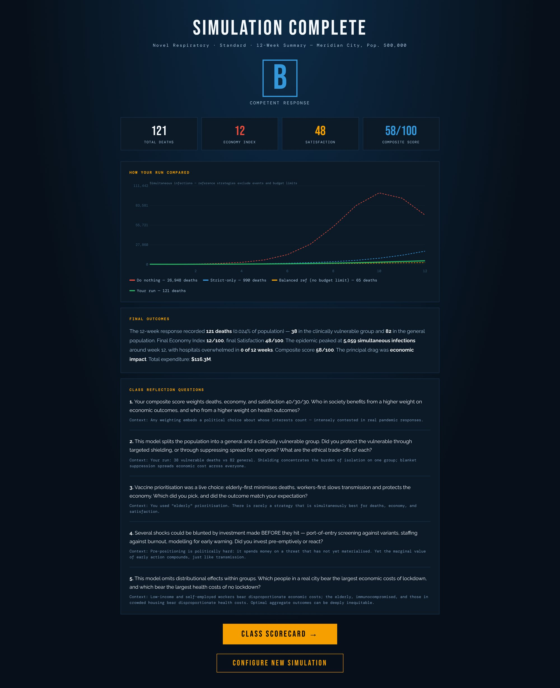

*The debrief: grade, summary tiles, comparison chart, outcomes and reflection questions.*

### Grade
A letter grade based on a **[composite score](#g-composite-score)**: 40% deaths, 30% final economy, 30% final [satisfaction](#g-satisfaction). The deaths part is 100 with no deaths and falls by 1 point per 100 deaths, so it reaches 0 at 10,000 deaths.

| [Composite](#g-composite-score) | Grade | Label |
|---|---|---|
| 87+ | A+ | EXEMPLARY |
| 72–86 | A | EXCELLENT |
| 55–71 | B | COMPETENT |
| 36–54 | C | ADEQUATE |
| 18–35 | D | POOR |
| 0–17 | F | CATASTROPHIC |
| Economy hit 0 in any week | F | ECONOMIC COLLAPSE |

### Summary tiles
Total deaths, final [Economy Index](#g-economy-index), final [Satisfaction](#g-satisfaction) and the [composite score](#g-composite-score).

### How Your Run Compared
Your infection curve against three [reference strategies](#g-reference-strategy). Each was run on the same [scenario](#g-scenario) and difficulty but **without any events**:

| Reference | What it does |
|---|---|
| **Do nothing** | No spending at all |
| **Strict-only** | Strict [lockdown](#g-lockdown) and communications level 1, every week |
| **Balanced ref (no [budget](#g-budget) limit)** | Moderate then mild [lockdown](#g-lockdown), staff 2, testing 2, communications 3, voluntary [shielding](#g-shielding), masks, early border screening and permanent beds, modelling 1, vaccination 3 when available, partial financial support for the first six weeks |

The legend shows each strategy's total deaths. The Balanced reference ignores the [budget](#g-budget) limit (it costs about $14M in week 1), and its label says so. It is a teaching benchmark, not a plan you can afford. Strict-only typically drives the economy and [satisfaction](#g-satisfaction) to zero.

### Final Outcomes
A paragraph covering total and per-group deaths, final indices, [peak](#g-peak) infections and the week it occurred, the number of weeks hospitals [overflowed](#g-overflow), the [composite score](#g-composite-score), your weakest dimension, and total spending.

### Class Reflection Questions
Five discussion questions on how the score is weighted, [shielding](#g-shielding) versus suppression, vaccine priority, investing in advance, and who bears the costs. Some include figures from your run.

### Buttons
- **CLASS SCORECARD →** opens the [lobby](#g-lobby) scorecard.
- **CONFIGURE NEW SIMULATION** returns to the briefing.

---

## 15. Screen 6 — Class Scorecard

The scorecard scores the same run from the point of view of each interest group, then scores the government on how well it served **all** of them.

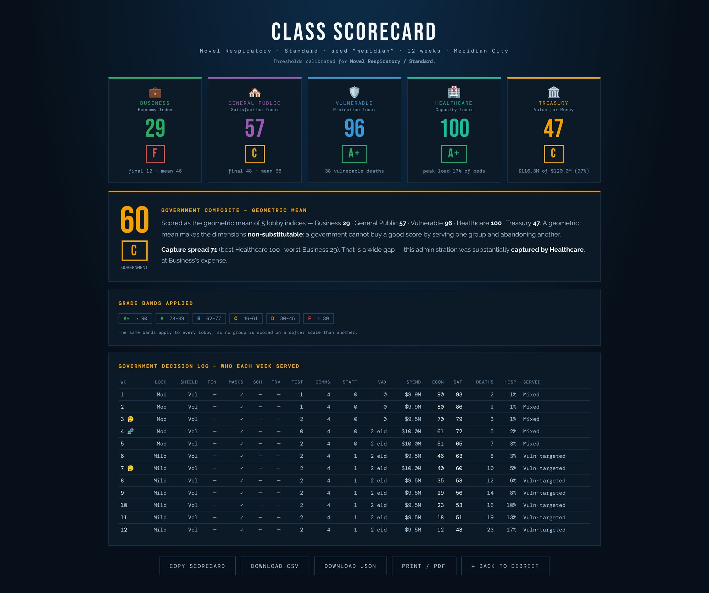

*The Class Scorecard in 5-lobby mode.*

### Lobby cards (0–100 each)

| [Lobby](#g-lobby) | [Index](#g-index) | What it measures |
|---|---|---|
| 💼 **Business** | [Economy Index](#g-economy-index) | Half the final economy plus half the average economy over the 12 weeks |
| 🏘️ **General Public** | [Satisfaction](#g-satisfaction) [Index](#g-index) | Half the final [satisfaction](#g-satisfaction) plus half the 12-week average |
| 🛡️ **Vulnerable** | Protection [Index](#g-index) | Vulnerable-group deaths, on a [log scale](#g-log-scale) (fewer is better) |
| 🏥 **Healthcare** (5-group mode) | Capacity [Index](#g-index) | [Peak](#g-peak) [hospital load](#g-hospital-load) as a percentage of capacity, on a [log scale](#g-log-scale) |
| 🏛️ **Treasury** (5-group mode) | Value for Money | How well Business, Public and Vulnerable did, with a bonus for spending less of the total [budget](#g-budget). Spending nothing and achieving nothing scores 0 |

Each card shows the [index](#g-index), its grade and the raw figure behind it.

### Government composite
The government score is the **[geometric mean](#g-geometric-mean)** of the active [lobby](#g-lobby) indices. Unlike a simple average, one very low score drags the whole result down, and a score of 0 for any [lobby](#g-lobby) makes the government score 0. You cannot score well by serving one group and abandoning another.

**[Capture spread](#g-capture-spread)** is the gap between the best- and worst-served [lobbies](#g-lobby). At **45 or more**, the scorecard says the government was "[captured](#g-capture)" by its best-served [lobby](#g-lobby).

### Grade bands
All [lobbies](#g-lobby) and the government use the same bands, which depend on difficulty:

| Grade | Standard | Hard |
|---|---|---|
| A+ | 90+ | 82+ |
| A | 78–89 | 70–81 |
| B | 62–77 | 55–69 |
| C | 46–61 | 40–54 |
| D | 30–45 | 25–39 |
| F | below 30 | below 25 |

Nightmare has no bands of its own; it uses the Hard bands and shows a warning that grades are indicative.

### Government Decision Log
A table with one row per week: [lockdown](#g-lockdown), [shielding](#g-shielding), financial support, masks, schools, travel, testing, communications, staff, vaccine level and priority, spending, economy, [satisfaction](#g-satisfaction), deaths, [hospital load](#g-hospital-load), and a **"Served"** label suggesting whose interests that week favoured:

| Label | Rule |
|---|---|
| Vulnerable | [Lockdown](#g-lockdown) tier + schools closed + travel restricted adds up to 3 or more |
| Vuln·targeted | [Shielding](#g-shielding) active with [lockdown](#g-lockdown) at None or Mild (and the Vulnerable rule not met) |
| Business | None of [lockdown](#g-lockdown), school closures, travel restrictions or [shielding](#g-shielding) |
| Mixed | Anything else |
| …+Public | Added when any financial support was given |

### Export buttons

| Button | Output |
|---|---|
| Copy scorecard | A plain-text summary copied to the clipboard, ready to paste into a chat or document |
| Download [CSV](#g-csv) | Summary, [lobby](#g-lobby) scores, raw outcomes and a week-by-week table: `outbreak-<scenario>-<difficulty>-<seed>.csv` |
| Download [JSON](#g-json) | The full record of the run, for collating a class's results: `outbreak-<scenario>-<difficulty>-<seed>.json` |
| Print / PDF | Prints the scorecard only, on a light background, ready to save as PDF |
| ← Back to debrief | Returns to the debrief |

---

## 16. Classroom (projection) mode

Select **Classroom** on the briefing screen, or press **Ctrl+Alt+C** (Cmd+Alt+C on a Mac) at any time.

### What changes
- Larger type, thicker chart lines and higher-contrast colours for projectors.
- The [epidemic curve](#g-epidemic-curve) takes the spare vertical space.
- To fit every control on screen without scrolling, the following are **hidden**: lever descriptions, Advisors and Model Notes. On short screens (950px high or less), policy notes are hidden too.
- Slider cost readouts show the level, for example `L2 · $1.2M`.
- Two view buttons appear in the header: **DEBATE** and **SCORES**.

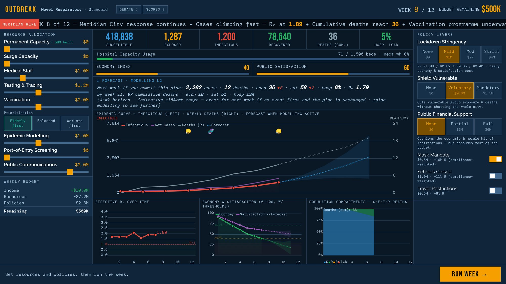

*Classroom mode at 1920×1080: every control fits on screen without scrolling.*

### Debate view (D)
Hides both control panels so the charts fill the screen. A **Current Proposal** bar shows the plan on the table in read-only form: every policy, every resource level, the vaccine setting, and the total committed (or **OVER** by how much). Use it while the room argues, then press D again to return to the controls.

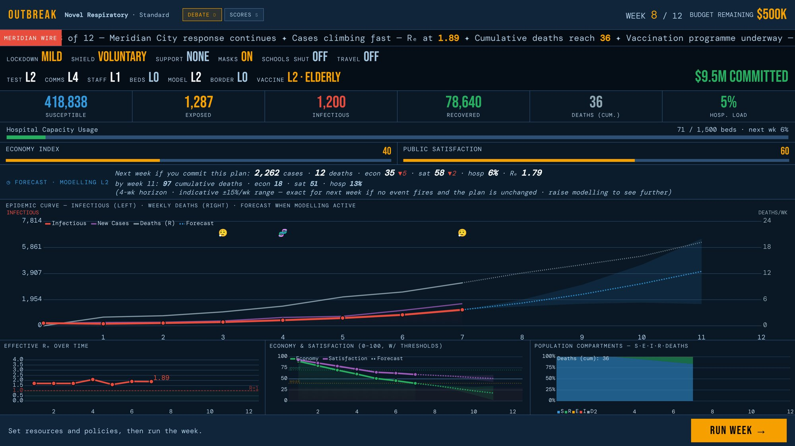

*Debate view: the controls are hidden and the Current Proposal bar shows the plan on the table.*

### Scores view (S)
Shows a live **[lobby](#g-lobby) scoreboard** under the ticker: each [lobby](#g-lobby)'s current [index](#g-index) and grade, and the government [composite](#g-composite-score) with its [capture spread](#g-capture-spread). It is off by default, for use at checkpoints. Before any week has run, all averages equal the starting values.

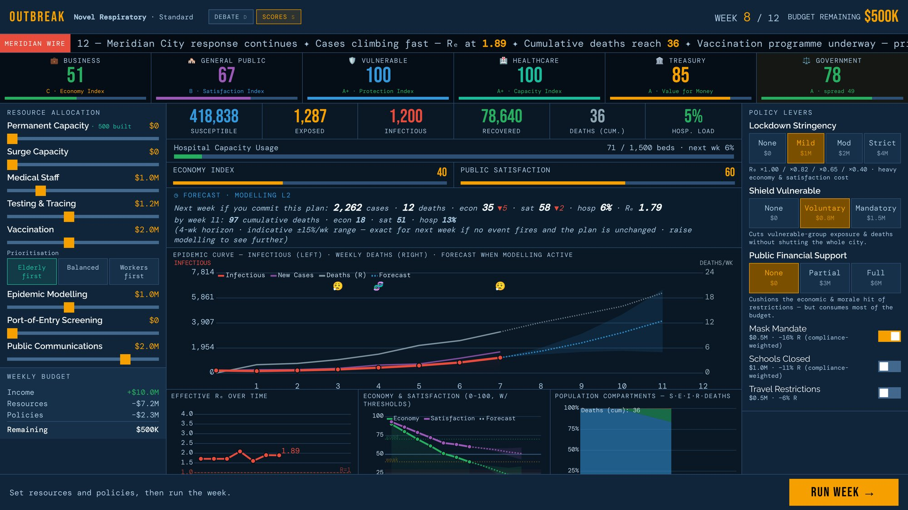

*The live [lobby](#g-lobby) scoreboard (S).*

> On a 1920×1080 projector, showing the scoreboard slightly clips the bottom row of charts, and turning on Debate view at the same time clips them heavily. Use one view at a time.

---

## 17. Keyboard shortcuts

| Key | Where | Action |
|---|---|---|
| Ctrl+Alt+C / Cmd+Alt+C | Anywhere | Toggle Solo / Classroom mode |
| D | Command Centre, Classroom mode | Toggle Debate view |
| S | Command Centre, Classroom mode | Toggle the [lobby](#g-lobby) scoreboard |

D and S are ignored while you are typing in a text field.

---

## 18. What participants commonly miss

These follow directly from how the model works. They are useful prompts when a group is struggling, or for the closing discussion. Consider whether to reveal them in advance: discovering them is part of the learning. The [User Guide](USER_GUIDE.md) explains how each control and event works, including what triggers events, but gives no strategy advice; the strategic points in this table are not in it.

| Common miss | What happens | Prompt you can use |
|---|---|---|
| Acting late | [Transmission](#g-transmission) compounds. Restrictions applied after the [peak](#g-peak) cost the economy and [satisfaction](#g-satisfaction) while saving few lives | "What did weeks 1–3 decide?" |
| Ignoring communications | Without them, [compliance](#g-compliance) is 55%. [Lockdown](#g-lockdown), mask and [shielding](#g-shielding) spending achieves only about half of what the panel suggests | "Why is your strict [lockdown](#g-lockdown) only giving ×0.67?" |
| Ordering beds late, or too few | Permanent beds ordered in week 1 serve all 12 weeks; the order resets each week, so groups that wait often forget to order at all | "How many beds did you actually need, and when?" |
| No border screening before week 3 | The [variant](#g-variant) arrives in week 3–5, and screening only helps if it has accumulated by then | "Could you have known the [variant](#g-variant) was coming?" |
| No modelling before it is needed | Modelling works a week [in arrears](#g-lag). Level 3+ in the previous week also softens the [variant](#g-variant) | "When did you decide you needed a [forecast](#g-forecast)?" |
| Blanket suppression instead of [shielding](#g-shielding) | [Shielding](#g-shielding) cuts vulnerable deaths at far less economic cost | "Who bore the cost of your strategy?" |
| Letting the economy hit 0 | One week at 0 means an automatic F on the debrief | "Was there a point of no return?" |
| Tripping event triggers | Testing ≤1 while cases rise ([super-spreader](#g-super-spreader)); staff ≤1 under high [hospital load](#g-hospital-load) (walkout); long hard [lockdown](#g-lockdown) while [satisfaction](#g-satisfaction) is low (protests) | "Was that event bad luck, or a consequence?" |
| Leaving masks off | Masks have no economic or [satisfaction](#g-satisfaction) cost | "What did masks cost you?" |
| Treating Slow Burn as one-off | [Immunity](#g-immune), including vaccine [immunity](#g-immune), wears off at 9% a week | "Why did the second wave come?" |

---

## 19. Model behaviours to pre-empt

The simulation is a simplified teaching model. The behaviours below are deliberate simplifications, and the interface describes them accurately, but participants regularly ask about them. Knowing them in advance lets you answer confidently, or turn them into discussion about the limits of models. The Technical Guide, §14, lists the full set, including the issues that have been fixed.

| Behaviour | What to tell the room |
|---|---|
| The [forecast](#g-forecast) was exactly right | The model has no randomness. With an unchanged plan, next week's projection is exact, and the strip says so. Higher modelling buys a longer view and a narrower range, not a more accurate next week |
| The [forecast](#g-forecast) for later weeks was wrong | It assumes no further events and that you keep the same plan |
| A [variant](#g-variant)'s effect disappeared the next week | A [variant](#g-variant) is a one-week surge, as the card states. Real [variants](#g-variant) usually persist; this is a simplification worth discussing |
| Vaccinated people became [susceptible](#g-susceptible) again | Vaccine [immunity](#g-immune) wears off at the same rate as natural [immunity](#g-immune), as the lever states |
| Medical staff did not help with the burnout event, and communications did not help with misinformation | Only the response chosen changes those events. Staffing and communications still help in general |
| Hospital strikes and protests were no worse on Hard | Those two events do not scale with difficulty |
| The Balanced reference did far better than we could | It is labelled "no [budget](#g-budget) limit": it costs about $14M in week 1. It is a benchmark, not an achievable plan |
| Strict-only did worst on economy | Strict-only drives the economy and [satisfaction](#g-satisfaction) to 0 in every [scenario](#g-scenario) |
| [Rₑ](#g-re) is above 1 but the curve is flattening | [Rₑ](#g-re) includes [immunity](#g-immune), but there is a short [lag](#g-lag) while infected people incubate, and waning adds people back to the [susceptible](#g-susceptible) group. [Rₑ](#g-re) is a guide, not an exact growth rate |
| Hospitals filled the moment infections rose | Bed use follows the number infected immediately; the model has no length-of-stay delay |

---

## 20. Planning and running a session

### Before the session
- **Test the projector.** Switch to Classroom mode and check that every control is visible without scrolling, and that the charts are legible from the back of the room. Projectors with a short screen (950px high or less) hide policy notes automatically.
- **Check the network.** If Google Fonts are blocked, the system fonts still work; nothing else needs the internet.
- **Fix the settings.** Agree a [seed](#g-seed), [scenario](#g-scenario) and difficulty. Every group with the same three settings faces the same [scheduled events](#g-scheduled-event), which keeps comparisons fair. Only Standard and Hard have [calibrated](#g-calibration) scorecard grades; Nightmare grades are marked as indicative.
- **Choose a [scenario](#g-scenario) for the learning goal:**

| Learning goal | Suggested [scenario](#g-scenario) |
|---|---|
| A first, balanced introduction | Novel Respiratory |
| Speed of response and hospital capacity | Fast & Deadly |
| Long-term management and reinfection | Slow Burn / [Endemic](#g-endemic) |
| Investing ahead of a threat | [Variant](#g-variant) Storm |

- **Play a run yourself** on the same settings, so that you know when the events land. The [seed](#g-seed) fixes the [scheduled events](#g-scheduled-event), though [triggered events](#g-triggered-event) depend on decisions.
- **Distribute the [User Guide](USER_GUIDE.md)** in advance if the group is new to the simulation.

### Session formats

| Format | How it works |
|---|---|
| **Whole class, one government** | One projected game. Participants are split into [lobbies](#g-lobby) and argue each week; the facilitator or an elected "director" enters the agreed plan |
| **Small groups, parallel games** | Each group plays on its own device with the same [seed](#g-seed). Compare scorecards at the end |
| **Individual** | Solo mode. Useful as homework or preparation; the advisors panel and model notes are visible in Solo mode only |

### Assigning lobbies
In 3-lobby mode, use Business, General Public and Vulnerable. In 5-lobby mode, add Healthcare and Treasury. Give each [lobby](#g-lobby) its [index](#g-index) from the Class Scorecard ([§15](#15-screen-6--class-scorecard)), so that each knows exactly what it is arguing for. Because the government is scored on a [geometric mean](#g-geometric-mean), a group that wins every argument for one [lobby](#g-lobby) will still score badly; this tension is the core of the exercise.

### Weekly rhythm
A suggested pattern for each week (adjust the time to your session length):

1. **Event.** If an event card appears, read it aloud and let [lobbies](#g-lobby) argue for a response, then choose.
2. **Debate view (D).** Show the charts and the Current Proposal bar. Each [lobby](#g-lobby) makes its case.
3. **Controls (D again).** Enter the agreed plan. If modelling was funded last week, the [forecast](#g-forecast) strip updates live, so the room can compare options before committing.
4. **Scores (S), optional.** Show the live [lobby](#g-lobby) scoreboard at checkpoints, for example in weeks 4, 8 and 12, rather than every week, so that the room argues from evidence and not from the scoreboard.
5. **Run the week and read the report.** Use the Reflection Prompt as a short discussion or writing point.

Twelve weeks at five minutes each is about an hour of play, plus the debrief. For a shorter session, set the debate time per week in advance and keep to it.

### Closing discussion
- Start with the **Debrief**: the grade, the comparison chart and the Final Outcomes paragraph.
- Use the **Class Reflection Questions**, which are designed for group discussion.
- Move to the **Class Scorecard**. Ask: which [lobby](#g-lobby) was best served, which worst, and was the government "[captured](#g-capture)"? Which week in the decision log decided the outcome?
- Ask what the model leaves out: the debrief's fifth reflection question addresses who bears the costs within groups. [§19](#19-model-behaviours-to-pre-empt) gives further examples of simplifications to discuss.

---

## 21. Assessment and collating results

- **Copy scorecard** gives a text summary that participants can paste into a submission.
- **Download [CSV](#g-csv)** gives one file per run, with a week-by-week table suitable for a spreadsheet. Filenames include the [scenario](#g-scenario), difficulty and [seed](#g-seed), so files from different groups do not collide unless the settings are identical; ask groups to rename them with a group name.
- **Download [JSON](#g-json)** holds the complete record, suitable for collating many runs with a script.
- **Print / PDF** produces a printable scorecard.

Possible assessment approaches:
- A written justification of the group's strategy, using its decision log and charts as evidence.
- A comparison across groups on the same [seed](#g-seed): why did similar strategies lead to different results?
- A critique of the scoring itself: who benefits from the 40/30/30 debrief [weighting](#g-weighting), and how would the outcome change under the scorecard's [geometric mean](#g-geometric-mean)?

---

## 22. Glossary

Definitions of the terms used in this guide. Most are the plain-English definitions from the participant [User Guide](USER_GUIDE.md); the rest come from the [Technical Guide](TECHNICAL_GUIDE.md), which has a fuller glossary.

| Term | Meaning |
|---|---|
| <a id="g-budget"></a>**Budget** | The money you can spend each week. Unspent money is lost |
| <a id="g-calibration"></a>**Calibration** | Choosing anchors and grade bands so that scores spread sensibly across the range of plausible play. |
| <a id="g-capture"></a>**Capture / captured** | When a government ends up serving one interest group at the expense of others |
| <a id="g-capture-spread"></a>**Capture spread** | The gap between the best- and worst-scoring interest groups |
| <a id="g-clinically-vulnerable"></a>**Clinically vulnerable** | People much more likely to become seriously ill or die if infected, such as the elderly |
| <a id="g-compartment"></a>**Compartment** | One of the groups people are sorted into: [susceptible](#g-susceptible), [exposed](#g-exposed), [infectious](#g-infectious), [recovered](#g-recovered) or dead |
| <a id="g-compliance"></a>**Compliance** | The share of people who actually follow your rules |
| <a id="g-composite-score"></a>**Composite score** | One score made by combining several others |
| <a id="g-contact-tracing"></a>**Contact tracing** | Finding the people an infected person has been near, so they can isolate |
| <a id="g-csv"></a>**CSV** | Comma-separated values: a plain-text table format that spreadsheets can open. |
| <a id="g-cumulative"></a>**Cumulative (cum.)** | A running total |
| <a id="g-deterministic"></a>**Deterministic** | Producing the same output every time for the same input; involving no randomness. |
| <a id="g-economy-index"></a>**Economy Index** | A score from 0 to 100 for the health of the city's economy |
| <a id="g-endemic"></a>**Endemic** | A disease that keeps returning, rather than disappearing after one outbreak |
| <a id="g-epidemic-curve"></a>**Epidemic curve** | A chart of how many people are infected over time |
| <a id="g-epidemic-modelling"></a>**Epidemic modelling** | Using maths and data to predict how a disease will spread |
| <a id="g-epidemic-threshold"></a>**Epidemic threshold** | R = 1. Above it, each case causes more than one new case on average, so infections grow; below it, they shrink. |
| <a id="g-epidemiologist"></a>**Epidemiologist** | A scientist who studies how diseases spread |
| <a id="g-exposed"></a>**Exposed** | Has caught the disease but cannot pass it on yet |
| <a id="g-fatality-rate"></a>**Fatality rate** | The share of infected people who die |
| <a id="g-forecast"></a>**Forecast** | A prediction of what will happen in the coming weeks |
| <a id="g-geometric-mean"></a>**Geometric mean** | A kind of average where one very low score pulls the total down a lot, and a zero makes it zero |
| <a id="g-horizon"></a>**Horizon** | How many weeks ahead a [forecast](#g-forecast) can see |
| <a id="g-hospital-load"></a>**Hospital load** | How full the hospitals are, as a percentage of available beds |
| <a id="g-immune"></a>**Immune / immunity** | Protected from catching the disease, for now |
| <a id="g-index"></a>**Index** | A score on a fixed scale, here 0 to 100 |
| <a id="g-indicative-range"></a>**Indicative range** | A rough guide to how far a [forecast](#g-forecast) might be off, not a precise prediction |
| <a id="g-infectious"></a>**Infectious** | Can pass the disease on to others |
| <a id="g-json"></a>**JSON** | JavaScript Object Notation: a structured text format for data, readable by most programming languages. |
| <a id="g-lag"></a>**Lag / in arrears** | Taking effect later than when paid for. Modelling funded this week produces a [forecast](#g-forecast) next week. |
| <a id="g-lobby"></a>**Lobby** | An interest group that pushes the government to serve its interests |
| <a id="g-lockdown"></a>**Lockdown** | Rules requiring people to stay at home and closing non-essential places |
| <a id="g-log-scale"></a>**Log scale** | A scale where each step means "ten times more" rather than "ten more" |
| <a id="g-multiplier"></a>**Multiplier** | A number that another quantity is multiplied by. For example, ×0.65 reduces [transmission](#g-transmission) to 65%. |
| <a id="g-one-off-order"></a>**One-off order** | Something you pay for once, not every week |
| <a id="g-overflow"></a>**Overflow** | More patients needing a hospital bed than there are beds |
| <a id="g-pathogen"></a>**Pathogen** | The germ (for example, a virus) that causes the disease |
| <a id="g-peak"></a>**Peak** | The point when the most people are infected at once |
| <a id="g-port-of-entry"></a>**Port of entry** | A place where people arrive in the city, such as an airport, station or port |
| <a id="g-r0"></a>**R₀ (R-nought)** | How many people, on average, one infected person passes the disease to when nobody is [immune](#g-immune) and nothing is being done |
| <a id="g-recovered"></a>**Recovered** | Had the disease (or was vaccinated) and is currently [immune](#g-immune) |
| <a id="g-reference-strategy"></a>**Reference strategy** | An example plan the game plays automatically, for comparison |
| <a id="g-re"></a>**Rₑ (R-effective)** | How many people, on average, one infected person actually passes the disease to, allowing for your policies and for people who are already [immune](#g-immune) |
| <a id="g-satisfaction"></a>**Satisfaction (Public Satisfaction)** | A score from 0 to 100 for how happy the public is with your handling of the crisis |
| <a id="g-scenario"></a>**Scenario** | Which disease, with which characteristics, you are facing |
| <a id="g-scheduled-event"></a>**Scheduled event** | An event whose week is fixed at the start of the game by the [seed](#g-seed). |
| <a id="g-seed"></a>**Seed** | A word that fixes which planned events happen in which weeks |
| <a id="g-severity"></a>**Severity** | The difficulty's [multiplier](#g-multiplier) for event strength. |
| <a id="g-shielding"></a>**Shielding** | Protecting vulnerable people specifically, instead of the whole city |
| <a id="g-super-spreader"></a>**Super-spreader** | One event or place that infects an unusually large number of people |
| <a id="g-susceptible"></a>**Susceptible** | Could catch the disease |
| <a id="g-transmission"></a>**Transmission** | The spread of the disease from person to person |
| <a id="g-triggered-event"></a>**Triggered (conditional) event** | An event that fires when the game state meets a condition. |
| <a id="g-variant"></a>**Variant** | A new version of the disease, here one that spreads more easily |
| <a id="g-waning-immunity"></a>**Waning immunity** | Protection from the disease wearing off over time |
| <a id="g-weighting"></a>**Weighting** | The relative importance given to each part of a [composite](#g-composite-score). |
