# OUTBREAK — User Guide

**For participants: the people playing the simulation.**

This guide explains how to play OUTBREAK, what every control does, and how to read the results. Every technical word is explained in plain English the first time it appears, and again in the [Glossary](#12-glossary) at the end.

If you are running a session for others, see the [Facilitator Guide](FACILITATOR_GUIDE.md). For the maths behind the simulation, see the [Technical Guide](TECHNICAL_GUIDE.md).

---

## Contents

1. [What you are doing](#1-what-you-are-doing)
2. [How you are judged](#2-how-you-are-judged)
3. [How a week works](#3-how-a-week-works)
4. [Before you start: the setup screen](#4-before-you-start-the-setup-screen)
5. [The main screen](#5-the-main-screen)
6. [Your resources (left side)](#6-your-resources-left-side)
7. [Your policies (right side)](#7-your-policies-right-side)
8. [Reading the numbers and charts](#8-reading-the-numbers-and-charts)
9. [Forecasts](#9-forecasts)
10. [Events](#10-events)
11. [After the game](#11-after-the-game)
12. [Glossary](#12-glossary)

---

## 1. What you are doing

A new disease has broken out in Meridian City, a city of 500,000 people. You are the Emergency Public Health Director, the official in charge of the city's response.

The game lasts **12 weeks**. Each week you decide:
- how to spend a fixed amount of money on **resources**, such as hospital beds, staff, testing and vaccines;
- which **policies**, or rules, to put in place, such as a [lockdown](#g-lockdown) or a mask mandate.

Then you run the week and see what happened.

The population is made up of two groups:
- the **general** population (82% of people);
- the **[clinically vulnerable](#g-clinically-vulnerable)** (18%). These are people, such as the elderly or those with serious health conditions, who are far more likely to need hospital care or to die if they catch the disease. They are about four times as likely to need a hospital bed, and roughly twelve to thirteen times as likely to die.

**Your decisions are final.** Once a week has run, you cannot undo it.

---

## 2. How you are judged

You are trying to balance three things that pull against each other:

| Goal | What it means |
|---|---|
| **Fewer deaths** | Keep as many people alive as possible, especially in the vulnerable group |
| **A healthy economy** | Keep businesses open and people working. Shown as the **[Economy Index](#g-economy-index)**, a score from 0 to 100 |
| **[Public satisfaction](#g-satisfaction)** | Keep the public on your side. Shown as **[Public Satisfaction](#g-satisfaction)**, a score from 0 to 100 |

Rules that slow the disease, such as a [lockdown](#g-lockdown), usually hurt the economy and annoy the public. Doing nothing protects the economy at first, but deaths then rise and damage both scores anyway. There is rarely one choice that is best for everything.

**One rule to remember:** if the [Economy Index](#g-economy-index) ever reaches **0**, you automatically get an F, however well you did on deaths.

At the end you get two sets of results:
- a **letter grade** on the Debrief screen;
- a **Class Scorecard**, where each interest group in the city (business, the public, the vulnerable, and possibly hospitals and the city treasury) scores you separately. See [§11](#11-after-the-game).

---

## 3. How a week works

1. **An event may happen.** Sometimes a card appears before you see the controls: a crisis or a piece of good news. You must choose how to respond.
2. **Make your plan.** Move the sliders and select your policies. Watch your remaining [budget](#g-budget).
3. **Press RUN WEEK →.** The simulation plays out seven days.
4. **Read the weekly report**, then press **CONTINUE →**.

**Your settings stay in place from one week to the next.** If you start a [lockdown](#g-lockdown) in week 2, it continues, and keeps costing money, until you turn it off.

**Money does not carry over.** Each week you get a fresh [budget](#g-budget). Anything you don't spend is lost.

---

## 4. Before you start: the setup screen

Your facilitator may already have chosen these settings for you.

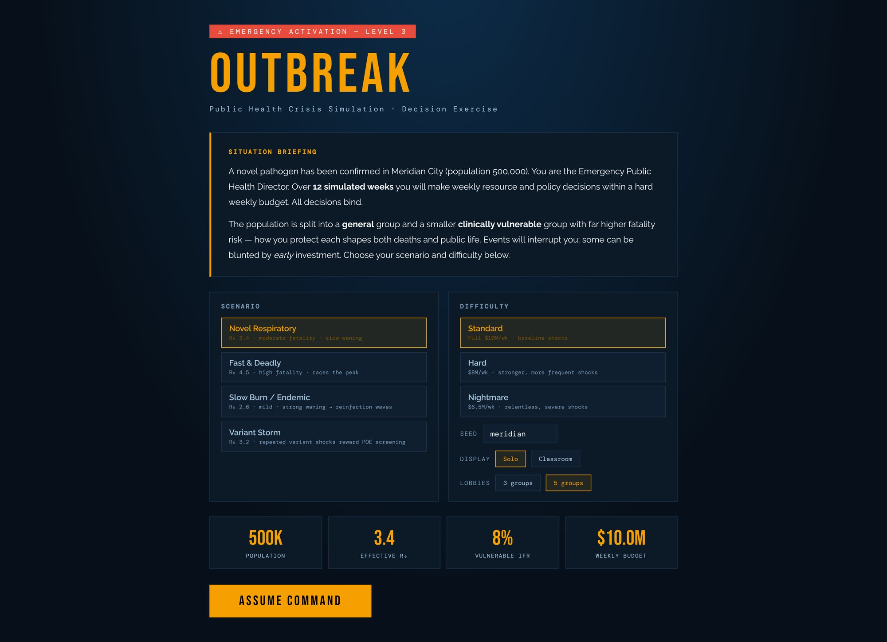

*The setup screen.*

**[Scenario](#g-scenario): which disease you face.**

| [Scenario](#g-scenario) | In plain terms |
|---|---|
| Novel Respiratory | A standard outbreak. A good place to start |
| Fast & Deadly | Spreads fast and kills more people. Vaccines arrive a week later (week 5) |
| Slow Burn / [Endemic](#g-endemic) | Milder, but [immunity](#g-immune) wears off quickly, so people can catch it again. "[Endemic](#g-endemic)" means the disease keeps coming back rather than disappearing |
| [Variant](#g-variant) Storm | New, more contagious versions of the disease keep arriving. Checking people at the border helps |

The setup screen shows **[R₀](#g-r0)** for each [scenario](#g-scenario). [R₀](#g-r0) (pronounced "[R-nought](#g-r0)") is the average number of people one infected person passes the disease to when nobody is [immune](#g-immune) and nothing is being done to stop it. An [R₀](#g-r0) of 3.4 means each case leads to about 3.4 more.

**Difficulty.** Standard ($10M a week), Hard ($8M a week, a more contagious disease, stronger crises) or Nightmare ($6.5M a week, harder still).

**[Seed](#g-seed).** A word that decides which crises happen in which weeks. Everyone using the same [seed](#g-seed), [scenario](#g-scenario) and difficulty gets the same planned events, which makes it fair to compare results.

**Display and [Lobbies](#g-lobby).** These are for the facilitator: they control the projector layout and how many interest groups score you.

Press **ASSUME COMMAND** to begin.

---

## 5. The main screen

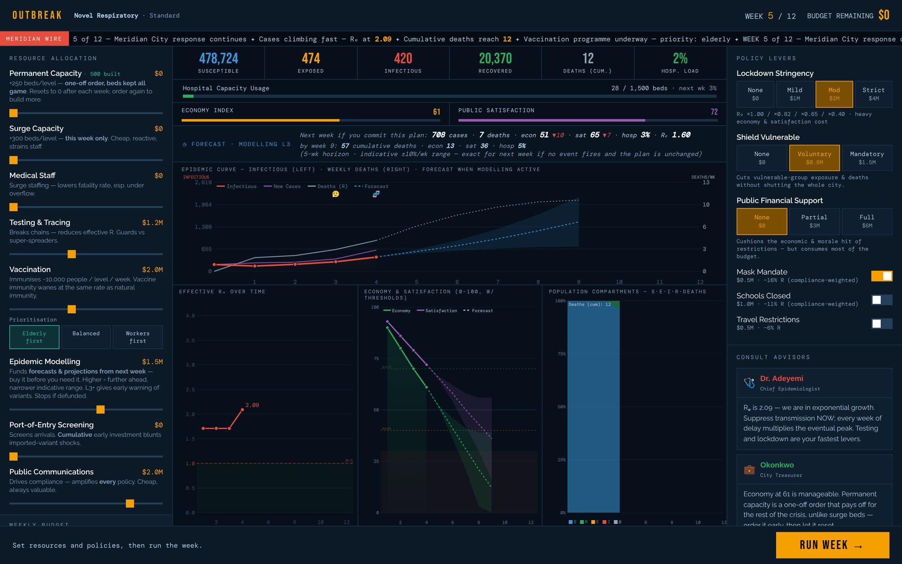

*The main screen part-way through a game. In Classroom mode it looks similar, with larger text and fewer descriptions.*

| Area | What it shows |
|---|---|
| **Top bar** | The [scenario](#g-scenario), the week (out of 12) and **[Budget](#g-budget) Remaining**: green is fine, amber means under 20% left, red means you are overspending |
| **News ticker** | Scrolling headlines about the current situation |
| **Left side** | Your **resources**: sliders, plus a breakdown of your weekly [budget](#g-budget) |
| **Middle** | Population figures, hospital use, the economy and [satisfaction](#g-satisfaction) scores, the [forecast](#g-forecast), and four charts |
| **Right side** | Your **policies**, plus advisors who give you advice (in Solo mode) |
| **Bottom** | The **RUN WEEK →** button. It is greyed out while you are over [budget](#g-budget) |

If your facilitator is projecting the game in **Classroom mode**, the screen uses larger text and hides the descriptions. They may also switch to **Debate view**, which hides the controls and shows a summary of the plan on the table while the room argues:

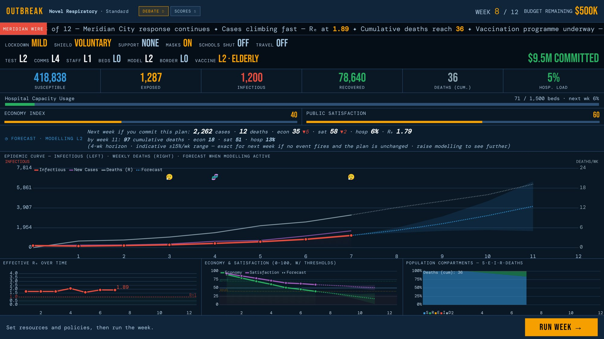

*Debate view in Classroom mode.*

---

## 6. Your resources (left side)

Each resource is a slider from **0 (none) to 5 (maximum)**. The price shown is what it costs **this week**. For most resources you pay again every week the slider is above 0; Permanent Capacity is the exception.

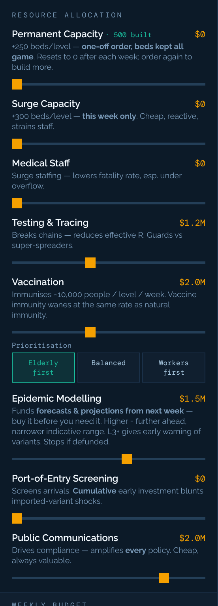

*The resource sliders.*

### Permanent Capacity: $1.5M per level
Builds **250 extra hospital beds per level, which you keep for the rest of the game**. The city starts with 1,000 beds.
> This is a **[one-off order](#g-one-off-order)**. You pay once, the beds stay, and the slider goes back to 0 after the week runs. The label next to the name shows how many beds you have built so far (for example "500 built"). To build more, order again in a later week.

### Surge Capacity: $0.6M per level
**300 extra beds per level, for this week only.** Cheaper, but temporary. "Surge" means a short-term boost to deal with a [peak](#g-peak), the busiest point of the outbreak.

### Medical Staff: $1.0M per level
More doctors and nurses. This lowers the **[fatality rate](#g-fatality-rate)**, the share of infected people who die, by up to 45% for the general group and 35% for the vulnerable group at level 5. It matters most when hospitals are full.

### Testing & Tracing: $0.6M per level
Finding infected people quickly and tracing their contacts (the people they have been near) so they can isolate. Each level cuts the spread of the disease by 5.5%. This works whether or not the public is following the rules.

### Vaccination: $1.0M per level
Available from **week 4** (week 5 in Fast & Deadly). Each level vaccinates about **10,000 people a week**. Vaccinated people become **[immune](#g-immune)**, meaning protected against catching it.
> [Immunity](#g-immune) **wears off over time** ("[waning immunity](#g-waning-immunity)"). In this game, vaccine [immunity](#g-immune) wears off at the same speed as [immunity](#g-immune) from having had the disease. In Slow Burn it wears off quickly.

Below the slider, choose who goes first:
- **Elderly first:** the vulnerable group first. This saves the most lives soonest.
- **Workers first:** the general group first. They do most of the spreading, so this slows the outbreak more.
- **Balanced:** both groups at once.

### Epidemic Modelling: $0.5M per level
Pays for experts to **[forecast](#g-forecast)**, or predict, what will happen next. **Paying this week gives you [forecasts](#g-forecast) from next week onwards.** A higher level lets you see further ahead, with a narrower range shown around the prediction. At level 3 or above, your experts also give you early warning of a more contagious [variant](#g-variant), which makes it less damaging when it arrives. See [§9](#9-forecasts).

### Port-of-Entry Screening: $0.5M per level
Checking people arriving at the city's borders: airports, stations and ports. It slightly slows the spread every week. Its main value is that **it builds up over time**. When a new, more contagious version of the disease (a **[variant](#g-variant)**) arrives, every level-week of screening you have already paid for makes it weaker, up to 75% weaker. The first [variant](#g-variant) always arrives in week 3, 4 or 5, so screening needs to start early. It costs the economy a little.

### Public Communications: $0.5M per level
Public messaging: adverts, briefings and announcements. This raises **[compliance](#g-compliance)**, the share of people who actually follow your rules. With no communications, only 55% of people comply, so your rules only work about half as well as they could. At level 5, everyone complies. It also improves [public satisfaction](#g-satisfaction) slightly while any restrictions are in place.

### Weekly Budget box
Shows your income for the week, your spending on resources, policies and any event response, and what remains. If the remaining figure is red, you cannot run the week until you cut something.

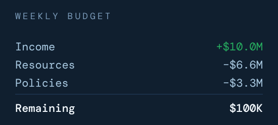

*Within [budget](#g-budget).*

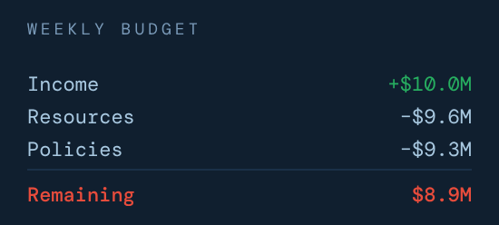

*Over [budget](#g-budget): you must cut something before you can run the week.*

---

## 7. Your policies (right side)

Click a button to choose a level, or flip a switch to turn a policy on or off. Every policy is paid for **every week** it is active.

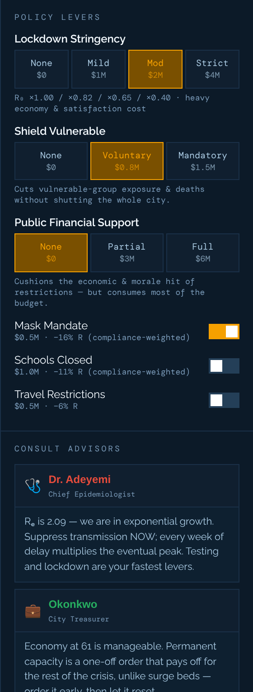

*The policy panel, with advisors below (Solo mode).*

Several policies show a figure such as "[R₀](#g-r0) ×0.65". This means the policy cuts the spread of the disease to 65% of its normal level, **if everyone complies**. With lower [compliance](#g-compliance), the effect is smaller.

### Lockdown Stringency
How strictly people are kept at home.

| Level | Cost a week | Effect on spread (full [compliance](#g-compliance)) | Economy hit a week | [Satisfaction](#g-satisfaction) hit a week |
|---|---|---|---|---|
| None | $0 | none | 0 | 0 |
| Mild | $1M | to 82% | −5 | −3 |
| Moderate | $2M | to 65% | −9 | −8 |
| Strict | $4M | to 40% | −17 | −13 |

### Shield Vulnerable
Protecting vulnerable people specifically, for example by asking them to stay at home and receive support, instead of closing the whole city.

| Level | Cost a week | Fewer vulnerable infections (full [compliance](#g-compliance)) |
|---|---|---|
| None | $0 | — |
| Voluntary | $0.8M | 40% |
| Mandatory | $1.5M | 68% |

It has a small cost to the economy and [satisfaction](#g-satisfaction). It does not slow the spread among everyone else.

### Public Financial Support
Payments to people and businesses affected by your restrictions.

| Level | Cost a week | Economic damage from restrictions absorbed |
|---|---|---|
| None | $0 | — |
| Partial | $3M | 40% |
| Full | $6M | 72% |

It also raises [satisfaction](#g-satisfaction) and [compliance](#g-compliance). It is expensive: Full support uses most of your [budget](#g-budget). It only reduces damage caused by your restrictions, not damage caused by deaths.

### On/off switches

| Policy | Cost a week | Effect |
|---|---|---|
| Mask Mandate | $0.5M | Cuts spread by up to 16% (depends on [compliance](#g-compliance)). **No cost to the economy or [satisfaction](#g-satisfaction)** |
| Schools Closed | $1.0M | Cuts spread by up to 11% (depends on [compliance](#g-compliance)). Hurts the economy and [satisfaction](#g-satisfaction) a little |
| Travel Restrictions | $0.5M | Cuts spread by 6%. Hurts the economy and [satisfaction](#g-satisfaction) a little |

**Effects stack.** For example, a moderate [lockdown](#g-lockdown) plus masks plus testing does more than any one of them alone.

---

## 8. Reading the numbers and charts

### The six numbers along the top
Everyone in the city is in one of these groups:

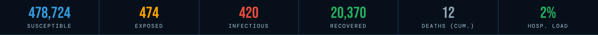

*The six population numbers.*

| Number | Plain meaning |
|---|---|
| **[Susceptible](#g-susceptible)** | Could catch the disease, including people whose [immunity](#g-immune) has worn off |
| **[Exposed](#g-exposed)** | Has caught it but cannot pass it on yet (about 6 days on average) |
| **[Infectious](#g-infectious)** | Can pass it on right now (about 8 days on average) |
| **[Recovered](#g-recovered)** | Currently [immune](#g-immune), after having it or being vaccinated |
| **Deaths ([cum.](#g-cumulative))** | Total deaths so far ("[cum.](#g-cumulative)" means [cumulative](#g-cumulative), a running total) |
| **[Hosp. Load](#g-hospital-load)** | How full the hospitals were last week, as a percentage of beds. Above 100% means more patients than beds |

### Hospital bar

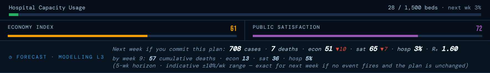

*The hospital bar, the Economy and [Satisfaction](#g-satisfaction) bars, and the [forecast](#g-forecast) strip.*

Beds in use out of beds available. **When hospitals [overflow](#g-overflow)** (more patients than beds), far more people die, and [public satisfaction](#g-satisfaction) drops. Keeping beds ahead of demand is one of the most important things you can do.

### Economy and Satisfaction bars
Both scores run from 0 to 100. Green or purple is good (70+), amber is weak (40–69), and red is bad (below 40).

- **The economy falls** with [lockdowns](#g-lockdown), school closures, travel restrictions, [shielding](#g-shielding), border screening and deaths. It **recovers** by 1.2 points a week when there is no [lockdown](#g-lockdown), no school closure, no travel restriction and no mandatory [shielding](#g-shielding).
- **[Satisfaction](#g-satisfaction) falls** with restrictions, deaths, full hospitals and large numbers of new cases. It **rises** with financial support, and with good communications while restrictions are in place.

### The charts

- **[Epidemic curve](#g-epidemic-curve)** (the big chart): how many people are [infectious](#g-infectious) each week (red), new cases (purple) and deaths per week (grey, measured on the right-hand scale). A dashed blue line shows the [forecast](#g-forecast) if you have one. A dashed "HOSP CAP" line shows roughly how many [infectious](#g-infectious) people it would take to fill the hospitals, based on who is currently infected; the hospital bar gives the exact figure. Small icons mark the weeks when events happened. **Hover** over a week for details.
- **Effective [Rₑ](#g-re) over time**: [Rₑ](#g-re) ("[R-effective](#g-re)") is the average number of people each infected person actually passed the disease to that week. It takes into account both your policies and the people who are already [immune](#g-immune). Below 1 (green), each case leads to less than one new case, so the outbreak is shrinking. Above 1 (red), each case leads to more than one, so it is growing.
- **Economy & [Satisfaction](#g-satisfaction)**: both scores over time, with guide lines at 70 (good) and 40 (weak).
- **Population [compartments](#g-compartment)**: the whole city as a stacked chart, showing what share of people are [susceptible](#g-susceptible), [recovered](#g-recovered), [exposed](#g-exposed), [infectious](#g-infectious) or dead. "[Compartment](#g-compartment)" just means one of these groups.

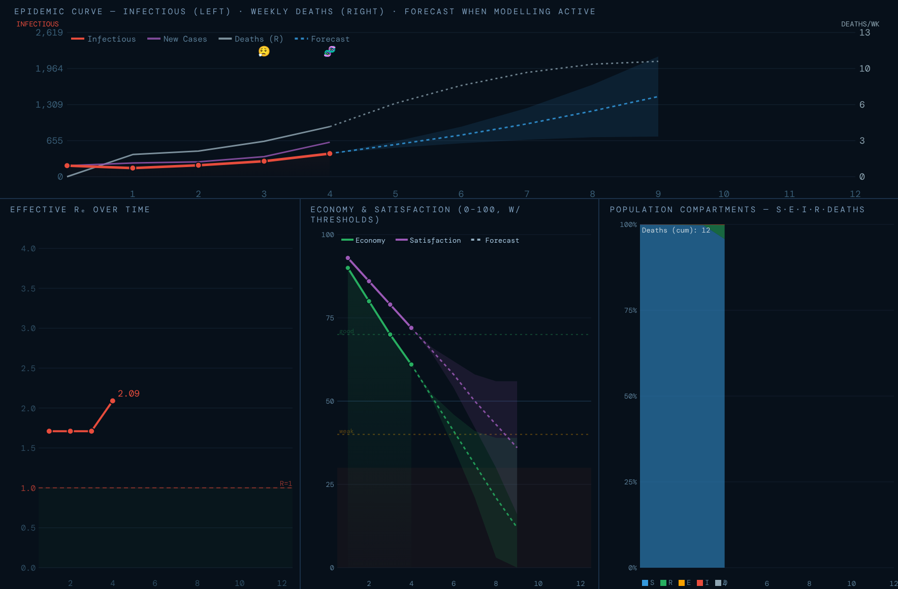

*The [epidemic curve](#g-epidemic-curve) (with a [forecast](#g-forecast)), and the [Rₑ](#g-re), economy & [satisfaction](#g-satisfaction), and population charts.*

### Advisors (Solo mode)
Three advisors give advice based on the current situation: an **[epidemiologist](#g-epidemiologist)** (a disease expert), a **treasurer** (in charge of the city's finances) and a **communications chief**. Each sees only their own side of the problem, so they may disagree.

---

## 9. Forecasts

If you paid for **[Epidemic Modelling](#g-epidemic-modelling) last week**, the strip above the [epidemic curve](#g-epidemic-curve) shows what will happen **next week if you commit to your current plan**: new cases, deaths, economy, [satisfaction](#g-satisfaction), hospital use and [Rₑ](#g-re). It also shows how things will stand a few weeks ahead.

- The [forecast](#g-forecast) **updates as you move the sliders**, so you can try out different plans before you commit.
- **Next week's figures are exact** if you don't change your plan. They already include any event you are dealing with this week.
- Weeks after that assume you keep the same plan and that **no new events happen**, so they can turn out differently.
- The shaded band around the [forecast](#g-forecast) line is an **[indicative range](#g-indicative-range)**: a rough guide to how far things might move, not a precise prediction. More modelling gives a narrower range and a longer view (3 to 6 weeks).
- If you set modelling to 0, the [forecast](#g-forecast) stops next week.

You have to pay for modelling **before** you need it.

---

## 10. Events

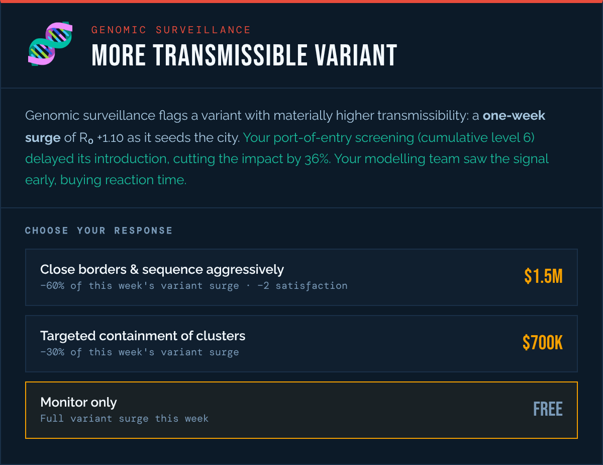

*An event card. The teal text shows how earlier choices have softened the blow.*

Events appear as a card at the start of a week. At most one happens per week. You **must** choose a response. Any cost comes out of this week's [budget](#g-budget), and **the effects last for this week only**.

**Some events are planned in advance** (fixed by the [seed](#g-seed)). A more contagious [variant](#g-variant) always appears in week 3, 4 or 5.

**Some events are caused by your own choices:**

| Event | Happens if… |
|---|---|
| Anti-Restriction Protests | You keep a moderate or strict [lockdown](#g-lockdown) for two or more weeks in a row while [satisfaction](#g-satisfaction) is below 55 |
| [Super-Spreader](#g-super-spreader) Cluster | Testing is at level 0 or 1, infections are rising, and more than 3,000 people are [infectious](#g-infectious). (A [super-spreader](#g-super-spreader) cluster is one event or place that infects a large number of people at once) |
| Hospital Staff Walkout | Medical Staff is at level 0 or 1 while hospitals are more than 80% full |

These only happen in weeks without a planned event, and never two weeks running.

### The events and your options

| Event | What it does | Options (cheapest last) |
|---|---|---|
| 🧬 **More Transmissible [Variant](#g-variant)** | A one-week surge in how easily the disease spreads. Earlier border screening, and modelling at level 3+, make it weaker | Close borders ($1.5M) · targeted containment ($0.7M) · monitor only (free) |
| 🏥 **Healthcare Worker Burnout** | Exhausted staff mean more deaths this week. Only your response changes how bad it is | Retention bonuses ($1.2M) · redeploy reserves ($0.5M) · push through (free, and [satisfaction](#g-satisfaction) falls) |
| 📱 **Misinformation Surge** | False information spreads, so fewer people follow the rules this week. Only your response changes how bad it is | Counter-messaging ($1.0M) · trusted local voices ($0.4M) · ignore it (free, and [satisfaction](#g-satisfaction) falls) |
| 😮‍💨 **[Lockdown](#g-lockdown) Fatigue** | People are tired of restrictions, so [lockdown](#g-lockdown) works less well | Support package ($1.0M) · renewed messaging ($0.5M) · do nothing (free, and [satisfaction](#g-satisfaction) falls) |
| 🤝 **International Aid Grant** (good news) | Extra money this week | $4M extra · or $3M extra plus 8,000 vaccine doses |
| 💉 **Vaccine Supply Windfall** (good news) | Extra vaccine doses this week | Fast-track ($0.4M, 22,000 doses) · standard (free, 13,000 doses) |
| 📢 **Anti-Restriction Protests** | [Satisfaction](#g-satisfaction) and [compliance](#g-compliance) hit | Ease restrictions (free, [lockdown](#g-lockdown) weaker) · hold firm (free, big [satisfaction](#g-satisfaction) loss) · dialogue and support ($1.0M) |
| 🦠 **[Super-Spreader](#g-super-spreader) Cluster** | A sudden jump of about 9,000 or more infections | Mass testing ($1.2M) · local [lockdown](#g-lockdown) ($0.5M) · [contact tracing](#g-contact-tracing) only (free) |
| ⛑️ **Hospital Staff Walkout** | Fewer working hospital beds this week | Meet demands ($1.2M) · agency and military staff ($0.5M) · refuse (free, big capacity loss) |

The card tells you, in teal text, when an earlier investment has softened the blow.

**Vaccine doses arriving early.** If extra doses arrive before vaccination has started, they are kept in storage and given out in the first week of vaccination. The card and the weekly report tell you when this happens.

---

## 11. After the game

### Weekly report (after every week)
Shows new cases, deaths, hospital use, [Rₑ](#g-re), the economy and [satisfaction](#g-satisfaction), with the change from last week, a short **intelligence report** (a summary of what happened and any warnings), and a **reflection question** to think or talk about.

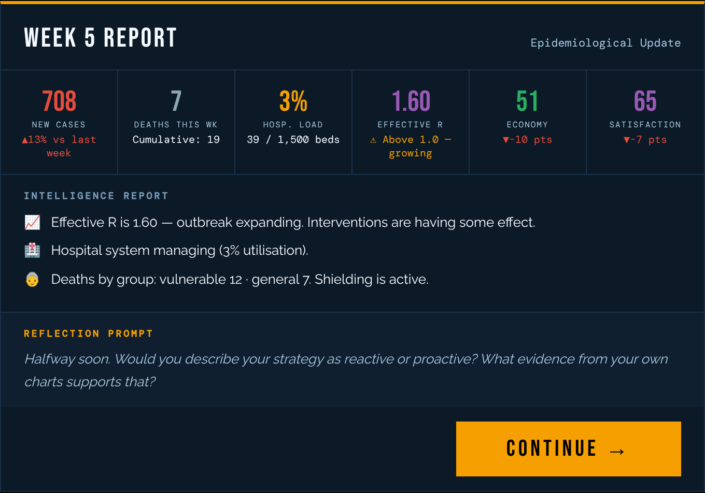

*A weekly report.*

### Debrief (after week 12)

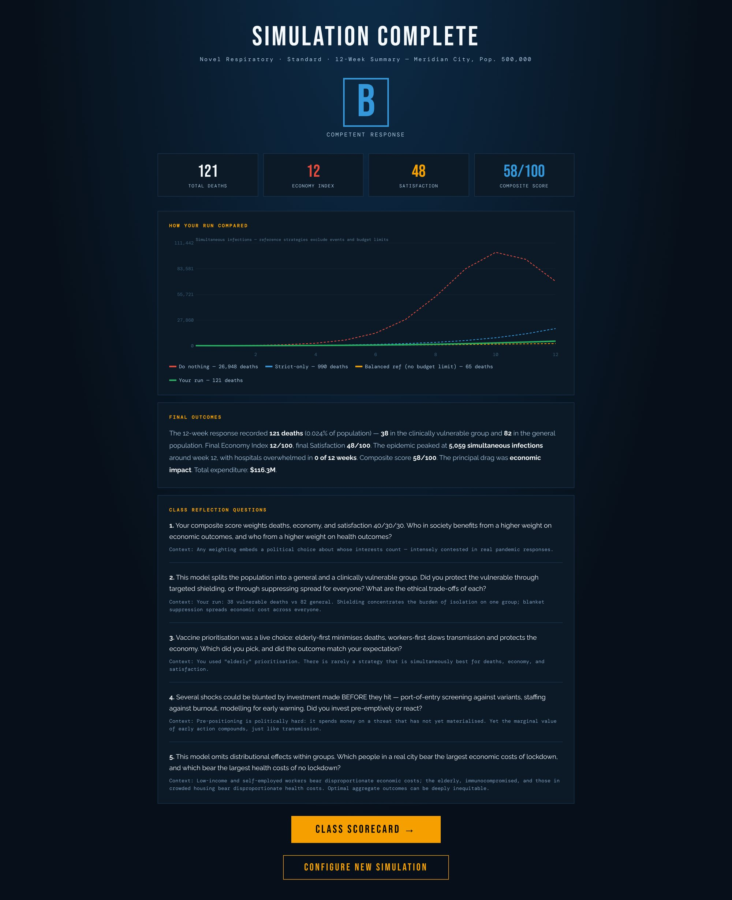

*The debrief screen.*

- A **letter grade** from A+ to F, based on a **[composite score](#g-composite-score)**, a single number made by combining several. It is 40% deaths, 30% final economy and 30% final [satisfaction](#g-satisfaction). The deaths part drops to 0 at 10,000 deaths.
- A chart comparing your outbreak with three example strategies, each played without any events: **do nothing**, **strict [lockdown](#g-lockdown) only**, and a **balanced** approach. The balanced example is labelled "no [budget](#g-budget) limit": it costs more than any weekly [budget](#g-budget), so you could not actually afford it.
- A summary of your results and some discussion questions.

### Class Scorecard

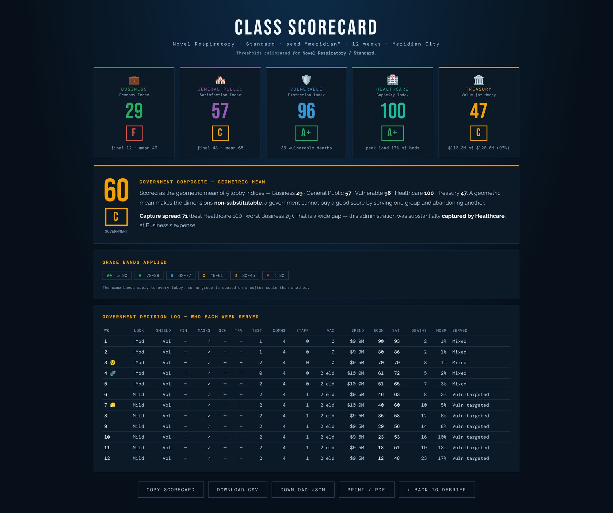

*The Class Scorecard.*

Each **[lobby](#g-lobby)**, an interest group that pushes the government to serve its interests, scores you from 0 to 100:

| [Lobby](#g-lobby) | Cares about |
|---|---|
| 💼 Business | The economy, both at the end and on average over the 12 weeks |
| 🏘️ General Public | [Satisfaction](#g-satisfaction), both at the end and on average |
| 🛡️ Vulnerable | How few vulnerable people died |
| 🏥 Healthcare | How full the hospitals got at their worst |
| 🏛️ Treasury | Good results for the money spent. Spending little and achieving nothing scores 0 |

The Vulnerable and Healthcare scores use a **[log scale](#g-log-scale)**, a scale where each step means "ten times more" rather than "ten more". Cutting deaths from 1,000 to 100 improves the score as much as cutting them from 10,000 to 1,000.

**The government score** combines all the [lobby](#g-lobby) scores using a **[geometric mean](#g-geometric-mean)**, a kind of average in which one very low score drags the whole result down, and a zero makes it zero. **You cannot do well by pleasing one group and abandoning another.**

**[Capture spread](#g-capture-spread)** is the gap between your best- and worst-served [lobbies](#g-lobby). A gap of 45 or more means your government was "**[captured](#g-capture)**", or effectively run for the benefit of one group.

The **decision log** lists what you did each week and suggests whose interests that week served.

You can **copy**, **download** (as a spreadsheet file or a data file) or **print** the scorecard.

---

## 12. Glossary

| Term | Plain-English meaning |
|---|---|
| **Budget** | The money you can spend each week. Unspent money is lost |
| **Capture / captured** | When a government ends up serving one interest group at the expense of others |
| **Capture spread** | The gap between the best- and worst-scoring interest groups |
| **Clinically vulnerable** | People much more likely to become seriously ill or die if infected, such as the elderly |
| **Compartment** | One of the groups people are sorted into: [susceptible](#g-susceptible), [exposed](#g-exposed), [infectious](#g-infectious), [recovered](#g-recovered) or dead |
| **Compliance** | The share of people who actually follow your rules |
| **Composite score** | One score made by combining several others |
| **Contact tracing** | Finding the people an infected person has been near, so they can isolate |
| **Cumulative (cum.)** | A running total |
| **Economy Index** | A score from 0 to 100 for the health of the city's economy |
| **Endemic** | A disease that keeps returning, rather than disappearing after one outbreak |
| **Epidemic** | A disease spreading quickly through a population |
| **Epidemic curve** | A chart of how many people are infected over time |
| **Epidemic modelling** | Using maths and data to predict how a disease will spread |
| **Epidemiologist** | A scientist who studies how diseases spread |
| **Exposed** | Has caught the disease but cannot pass it on yet |
| **Fatality rate** | The share of infected people who die |
| **Forecast** | A prediction of what will happen in the coming weeks |
| **Geometric mean** | A kind of average where one very low score pulls the total down a lot, and a zero makes it zero |
| **Horizon** | How many weeks ahead a [forecast](#g-forecast) can see |
| **Hospital load** | How full the hospitals are, as a percentage of available beds |
| **Immune / immunity** | Protected from catching the disease, for now |
| **Indicative range** | A rough guide to how far a [forecast](#g-forecast) might be off, not a precise prediction |
| **Index** | A score on a fixed scale, here 0 to 100 |
| **Infectious** | Can pass the disease on to others |
| **Lobby** | An interest group that pushes the government to serve its interests |
| **Lockdown** | Rules requiring people to stay at home and closing non-essential places |
| **Log scale** | A scale where each step means "ten times more" rather than "ten more" |
| **One-off order** | Something you pay for once, not every week |
| **Overflow** | More patients needing a hospital bed than there are beds |
| **Pathogen** | The germ (for example, a virus) that causes the disease |
| **Peak** | The point when the most people are infected at once |
| **Port of entry** | A place where people arrive in the city, such as an airport, station or port |
| **R₀ (R-nought)** | How many people, on average, one infected person passes the disease to when nobody is [immune](#g-immune) and nothing is being done |
| **Rₑ (R-effective)** | How many people, on average, one infected person actually passes the disease to, allowing for your policies and for people who are already [immune](#g-immune) |
| **Recovered** | Had the disease (or was vaccinated) and is currently [immune](#g-immune) |
| **Reference strategy** | An example plan the game plays automatically, for comparison |
| **Satisfaction (Public Satisfaction)** | A score from 0 to 100 for how happy the public is with your handling of the crisis |
| **Scenario** | Which disease, with which characteristics, you are facing |
| **Seed** | A word that fixes which planned events happen in which weeks |
| **Shielding** | Protecting vulnerable people specifically, instead of the whole city |
| **Super-spreader** | One event or place that infects an unusually large number of people |
| **Surge capacity** | Temporary extra hospital beds, for one week only |
| **Susceptible** | Could catch the disease |
| **Threshold** | A level that, once crossed, changes what happens. For R, the threshold is 1 |
| **Transmission** | The spread of the disease from person to person |
| **Vaccination priority** | Which group gets vaccinated first |
| **Variant** | A new version of the disease, here one that spreads more easily |
| **Waning immunity** | Protection from the disease wearing off over time |
